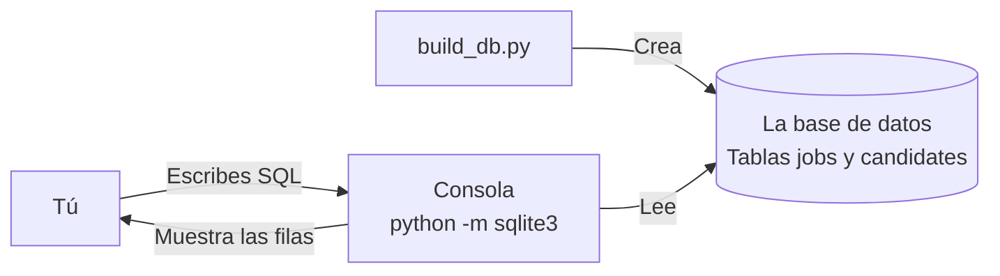

# 🔭 1.1 · Tu primera base de datos

| ⏱️ Duración | 🧪 Tipo | 🏷️ Tipo de tema | 🛠️ Stack |
|---|---|---|---|
| 1–2 h | 🔭 `exploration` | 🎯 `core` | Python 3.12+ · `sqlite3` (SQLite 3.45+) |

## 🎯 Objetivos
- Crear una base de datos SQLite con un script y abrirla en la consola `python -m sqlite3`.
- Listar las tablas de una base consultando `sqlite_schema`, y las columnas de una tabla con sus tipos.
- Hacer tu primera consulta, `SELECT * FROM …`, y leer su resultado fila por fila.
- Explicar con tus palabras qué son una tabla, una fila, una columna y un tipo de dato.
- Reconocer los dos tropiezos más comunes al empezar: la instrucción sin `;` y el archivo mal escrito.

## 💡 Por qué importa
Casi toda empresa guarda sus datos en bases de datos, no en hojas de cálculo, y SQL es el idioma para pedírselos: lo vas a usar en reportes, en análisis y en el código de una aplicación. En este lab abres una base por primera vez, miras qué tiene adentro y le haces tu primera pregunta. Todo lo demás del curso parte de aquí.

## 📍 Dónde correr los comandos
Los comandos se escriben en una **terminal**: la ventana donde escribes una orden y presionas Enter. En VS Code, ábrela con el menú *Terminal → Nuevo terminal* (*Terminal → New Terminal* si VS Code está en inglés); se abre en la carpeta del repositorio. Si nunca la usaste, la [guía de la terminal de VS Code](https://code.visualstudio.com/docs/terminal/basics) explica lo básico en cinco minutos.

1. Activa el entorno virtual como en el paso 2 de [SETUP.md](../../../SETUP.md). El prompt empieza con `(.venv)`.
2. Entra a la carpeta `demo/` de este lab.

PowerShell o Bash:

```bash
cd labs/01-query-a-table/01-first-database/demo
pwd
```

La ruta que muestra `pwd` tiene que terminar en `demo`. Todos los comandos del lab se corren desde ahí.

## 🧠 Conceptos

### Una base de datos guarda tus datos y responde preguntas sobre ellos (*database*)
En una hoja de cálculo de Excel buscas a mano, filtras con el mouse y, si dos personas trabajan cada una con su copia del archivo, terminan con dos versiones distintas. Una **base de datos** guarda los datos organizados y deja que un programa, el **motor** (*database engine* o DBMS, *database management system*), los busque por ti: tú le haces una pregunta y el motor te devuelve la respuesta. Hay motores que corren como un servidor al que se conectan muchas personas, como PostgreSQL o MySQL. **SQLite** es un motor que no necesita servidor: viene dentro de Python, en el módulo `sqlite3`, y por eso no instalas nada más.

### Las tablas se parecen a una hoja de cálculo, con reglas más estrictas (*table*, *row*, *column*)
Los datos de una base viven en **tablas**. Una tabla se parece a una hoja de Excel: cada **fila** (*row*) es un registro, por ejemplo un producto, y cada **columna** (*column*) es un dato de ese registro, por ejemplo su precio. Una tabla `products` podría verse así:

| id | name | price | stock |
|---|---|---|---|
| 1 | Cuaderno A4 | 3.5 | 120 |
| 2 | Lapicero azul | 0.8 | 500 |

La comparación con Excel sirve hasta aquí: en una tabla, cada columna tiene un nombre fijo y está pensada para una sola clase de dato, todas las filas tienen las mismas columnas y no hay celdas sueltas fuera de ellas. Una base que organiza sus datos en tablas así se llama **base de datos relacional** (*relational database*). Es el tipo de base que vas a ver en casi todos los trabajos.

### Cada columna declara qué clase de dato guarda (*data type*)
Si una columna `price` mezclara números con textos como "barato", no podrías sumarla. Por eso, al crear una tabla, cada columna declara su **tipo de dato** (*data type*). En la tabla `products` de arriba, `name` sería `TEXT` (texto), `price` sería `REAL` (un número con decimales) y `stock` sería `INTEGER` (un número entero). Hay más tipos, y cada motor tiene los suyos. SQLite es más flexible que otros motores con los tipos, y eso trae sorpresas: el lab 3.2 las muestra.

### Con SQL pides el qué, no el cómo (*declarative language*)
En Python, para ver todos los productos, escribirías los pasos: abrir el archivo, recorrer las líneas con un `for`, imprimir cada una. En **SQL** (*Structured Query Language*, el lenguaje de las bases relacionales) describes el resultado que quieres, y el motor decide cómo conseguirlo. Por eso se dice que SQL es un lenguaje **declarativo** (*declarative*). Esta instrucción pide todas las columnas (`*`) de todas las filas de la tabla `products`:

```sql
SELECT * FROM products;
```

Cada pregunta que le haces a la base se llama **consulta** (*query*). Una instrucción SQL (*statement*) termina en punto y coma. En el curso escribimos las palabras de SQL en mayúsculas (`SELECT`, `FROM`) para distinguirlas de los nombres de tablas y columnas.

### La base se describe a sí misma (*schema*, *shell*)
Al abrir una base que no conoces, lo primero es saber qué tablas tiene. La descripción de las tablas de una base, con sus columnas y sus tipos, se llama **esquema** (*schema*). SQLite guarda el esquema en una tabla especial, `sqlite_schema`, que mantiene solo: tiene una fila por cada tabla de la base (y por otros objetos que verás más adelante, como los índices). Como es una tabla, se consulta con SQL. En vez de `*` puedes nombrar las columnas que quieres ver; el lab 1.2 trabaja esto a fondo:

```sql
SELECT name FROM sqlite_schema;
```

Para escribir consultas usarás la **consola** (*shell*) de SQLite que trae Python: un programa que abres en la terminal con `python -m sqlite3 <archivo>`, donde escribes SQL, presionas Enter y ves el resultado. Sus propios comandos empiezan con un punto, como `.help` o `.quit`.

## 📚 Documentación
- [Python: la consola de `sqlite3` (*Command-line interface*)](https://docs.python.org/3/library/sqlite3.html#command-line-interface)
- [SQLite: la tabla del esquema (*The Schema Table*)](https://www.sqlite.org/schematab.html)
- [SQLite: `PRAGMA table_info`](https://www.sqlite.org/pragma.html#pragma_table_info), que lista las columnas de una tabla
- [SQLite: tipos de datos (*Datatypes In SQLite*)](https://www.sqlite.org/datatype3.html)

## 🧭 Escenario
Una bolsa de trabajo pequeña guarda sus ofertas de empleo y sus postulantes en una base SQLite. En [`demo/`](demo/) está [`build_db.py`](demo/build_db.py), un script que crea esa base desde cero: una tabla `jobs` con las ofertas y una tabla `candidates` con los postulantes. El script está terminado; no tienes que cambiarlo. Vas a crear la base, abrirla, recorrer sus tablas y consultarlas.

El diagrama muestra quién hace qué: el script crea la base, y tú hablas con ella a través de la consola.



> [!NOTE]
> [`demo/tests/`](demo/tests/test_build_db.py) comprueba que el script arma la base tal como la describe esta guía, y [`demo/pyproject.toml`](demo/pyproject.toml) le dice a pytest dónde están esas pruebas. No necesitas abrirlos ni cambiarlos; en el lab 1.2 aprendes a correr pruebas.

## 🧪 Experimentos
Antes de cada paso, escribe tu predicción en un papel o en un archivo de notas. Después corre el comando y compara: lo que importa es entender por qué acertaste o fallaste.

Las salidas de los 👀 se verificaron en Windows 11 con Python 3.12.16 y 3.15.2 (SQLite 3.53.1), en PowerShell 5.1 y Git Bash; los experimentos 1 a 6 se repitieron con SQLite 3.45.3, la versión más antigua que admite el curso, con la misma salida. Donde la salida cambia según la versión de Python, el 👀 lo dice.

### Experimento 1 · Crear la base
🔮 **Predict first:** el script crea una base con dos tablas. ¿Qué aparecerá en la carpeta `demo/`: un archivo por tabla, un solo archivo o una carpeta nueva?

PowerShell o Bash:

```bash
python build_db.py
```

Para ver los archivos con su tamaño, en PowerShell:

```powershell
ls
```

En Bash, `ls` muestra solo los nombres; agrega `-l` para ver el tamaño:

```bash
ls -l
```

<details><summary>👀 Qué deberías ver</summary>

```text
Listo: jobs.db creado con 2 tablas.
```

Hay un solo archivo nuevo, `jobs.db`, junto a `build_db.py`, `pyproject.toml` y `tests`. Pesa 12288 bytes (12 KB): en PowerShell, el tamaño está en la columna `Length`; en Bash, es el número que va antes de la fecha.

```text
-a----        25/11/2026     15:46          12288 jobs.db
```

```text
-rw-r--r-- 1 tu-usuario 197609 12288 Nov 25 15:46 jobs.db
```

La primera línea es de PowerShell y la segunda de Bash; tus fechas, tu usuario y el número de grupo serán otros.

**Toda la base, con sus dos tablas y sus filas, vive en ese único archivo.** Es una diferencia grande con PostgreSQL o MySQL, donde los datos están en un servidor. El archivo no es texto (sus primeros bytes dicen `SQLite format 3`): no lo abras ni lo edites en el editor; se lee con SQL. Si algo sale mal en los experimentos, vuelve a correr `python build_db.py`: borra la base y la crea de nuevo.
</details>

### Experimento 2 · Abrir la base y ver sus tablas
Abre la consola sobre la base. A partir de aquí escribes dentro de la consola, después del prompt `sqlite>`, y terminas cada línea con Enter.

PowerShell o Bash:

```bash
python -m sqlite3 jobs.db
```

> [!NOTE]
> Si usas Git Bash en Windows y no aparece el prompt `sqlite>`, abre la consola desde PowerShell.

Pide la ayuda de la consola:

```text
.help
```

🔮 **Predict first:** `sqlite_schema` también es una tabla de la base. Cuando listes las tablas, ¿aparecerá ella misma en la lista, junto a `jobs` y `candidates`?

```sql
SELECT name FROM sqlite_schema;
```

<details><summary>👀 Qué deberías ver</summary>

Al abrir, la consola dice con qué versión de SQLite corre y qué archivo abrió (tu versión puede ser otra; el curso necesita 3.45 o superior):

```text
sqlite3 shell, running on SQLite version 3.53.1
Connected to 'jobs.db'

Each command will be run using execute() on the cursor.
Type ".help" for more information; type ".quit" or CTRL-Z to quit.
```

La línea de `execute()` cuenta cómo la consola le pasa cada instrucción a la base desde Python (`execute()` y *cursor* son parte del módulo `sqlite3`, que usarás en el lab 5.3); por ahora no necesitas nada de eso. La última dice cómo salir: `.quit`, o la tecla CTRL-Z en Windows (en Linux y macOS dice CTRL-D). Usa `.quit`, que es igual en todos los sistemas.

`.help` en Python 3.15 muestra los tres únicos comandos de esta consola (dice CTRL-D aunque estés en Windows); en Python 3.12 a 3.14 dice solo `Enter SQL code and press enter.`:

```text
Enter SQL code or one of the below commands, and press enter.

.version    Print underlying SQLite library version
.help       Print this help message
.quit       Exit the CLI, equivalent to CTRL-D
```

La consulta devuelve dos filas, una por tabla:

```text
('jobs',)
('candidates',)
```

**`sqlite_schema` no aparece en su propia lista:** describe las tablas que tú creas, no a sí misma ([así lo dice su documentación](https://www.sqlite.org/schematab.html)). Cada fila del resultado se muestra como una tupla de Python, entre paréntesis; la coma final de `('jobs',)` es la forma en que Python escribe una tupla de un solo valor.

Si vienes de un tutorial que usa `.tables` o `.schema`: esos comandos son de la consola oficial de SQLite, no de esta. En Python 3.13 o superior verás un error que empieza con `Error: unknown command` y nombra `"tables"` (el resto del mensaje cambia según la versión). En Python 3.12 la consola lo toma como el comienzo de una instrucción SQL y muestra `...`; escribe `;` y Enter, y verás `OperationalError (SQLITE_ERROR): near ".": syntax error`.
</details>

### Experimento 3 · Las columnas y sus tipos
Un **pragma** es un comando propio de SQLite, que no es parte del SQL estándar, para ver o cambiar cómo funciona la base. `pragma_table_info('<tabla>')` es la versión de uno de ellos que se consulta como si fuera una tabla: devuelve una fila por cada columna de la tabla que le nombras. Su columna `name` tiene el nombre de cada columna, y `type`, su tipo.

🔮 **Predict first:** la columna `posted_on` de `jobs` guarda la fecha de publicación de la oferta. ¿Qué tipo crees que tiene?

```sql
SELECT name, type FROM pragma_table_info('jobs');
```

<details><summary>👀 Qué deberías ver</summary>

```text
('id', 'INTEGER')
('title', 'TEXT')
('company', 'TEXT')
('city', 'TEXT')
('mode', 'TEXT')
('salary_usd', 'INTEGER')
('posted_on', 'TEXT')
```

**`posted_on` es `TEXT`.** SQLite no tiene un tipo de fecha: las fechas se guardan como texto con el formato `AAAA-MM-DD` (por ejemplo `2026-11-03`), que se ordena bien como texto. PostgreSQL y MySQL sí tienen un tipo `DATE`. El lab 1.6 enseña a trabajar con fechas guardadas así.

`id` es un número que identifica a cada fila; en el lab 2.1 verás por qué casi toda tabla tiene uno.
</details>

Mira también las columnas de `candidates`:

```sql
SELECT name, type FROM pragma_table_info('candidates');
```

<details><summary>👀 Qué deberías ver</summary>

```text
('id', 'INTEGER')
('name', 'TEXT')
('city', 'TEXT')
('years_experience', 'REAL')
```

`years_experience` es `REAL`: los años de experiencia pueden tener decimales, como `0.5` para seis meses.
</details>

### Experimento 4 · Tu primera consulta
🔮 **Predict first:** `jobs` tiene 8 ofertas. ¿Cómo crees que la consola mostrará el resultado: como una tabla con bordes y encabezados, como en Excel, o de otra forma? ¿En qué se notará qué columnas son texto y cuáles números?

```sql
SELECT * FROM jobs;
```

<details><summary>👀 Qué deberías ver</summary>

```text
(1, 'Analista de datos júnior', 'Andes Retail', 'Lima', 'híbrido', 1200, '2026-11-03')
(2, 'Desarrollador backend', 'Pago Fácil', 'Bogotá', 'remoto', 1800, '2026-11-05')
(3, 'Soporte de TI', 'Clínica Central', 'Arequipa', 'presencial', 800, '2026-11-06')
(4, 'Analista de BI', 'Andes Retail', 'Lima', 'presencial', 1500, '2026-11-10')
(5, 'Practicante de datos', 'Agro Norte', 'Trujillo', 'presencial', 600, '2026-11-12')
(6, 'Desarrolladora full stack', 'Pago Fácil', 'Ciudad de México', 'remoto', 2000, '2026-11-14')
(7, 'Administrador de bases de datos', 'Banco Sur', 'Santiago', 'híbrido', 2400, '2026-11-18')
(8, 'Analista de calidad (QA)', 'Clínica Central', 'Lima', 'remoto', 1100, '2026-11-20')
```

Una tupla por fila, sin encabezados ni bordes: esta consola es sencilla e imprime cada fila como Python. Los valores salen en el orden de las columnas que viste en el experimento 3 (`id`, `title`, `company`…). **Los textos van entre comillas y los números no**: así distingues `1200`, un `INTEGER`, de `'2026-11-03'`, un `TEXT`.
</details>

Ahora consulta la otra tabla, escribiendo la instrucción en minúsculas:

```sql
select * from candidates;
```

<details><summary>👀 Qué deberías ver</summary>

```text
(1, 'Ana Quispe', 'Lima', 0.5)
(2, 'Luis Ramírez', 'Bogotá', 2.0)
(3, 'María Torres', 'Arequipa', 1.0)
(4, 'Jorge Huamán', 'Lima', 0.0)
(5, 'Sofía Castro', 'Santiago', 3.5)
```

Funciona igual: a SQL no le importan las mayúsculas en sus palabras clave. Las escribimos en mayúsculas solo para leer mejor. Los años de experiencia salen como `2.0` y no como `2` porque la columna es `REAL`.
</details>

### Experimento 5 · Olvidar el punto y coma
🔮 **Predict first:** escribe la consulta de abajo **sin** el punto y coma final y presiona Enter. ¿Qué crees que hará la consola: mostrar las filas, mostrar un error, o algo distinto?

```text
SELECT * FROM candidates
```

<details><summary>👀 Qué deberías ver</summary>

Ni filas ni error. La consola cambia el prompt `sqlite>` por `...` y se queda esperando:

```text
sqlite> SELECT * FROM candidates
    ...
```

Sin el `;`, la consola entiende que la instrucción sigue en la línea siguiente, porque una instrucción SQL puede ocupar varias líneas. Escribe `;` y presiona Enter: la instrucción se completa y aparecen las 5 filas de `candidates`. **Si alguna vez ves `...` y nada pasa, te falta el punto y coma.**
</details>

### Experimento 6 · Un nombre mal escrito
Sal de la consola:

```text
.quit
```

Ahora ábrela otra vez, pero escribe mal el nombre del archivo: `job.db`, sin la `s`. Y lista sus tablas, como en el experimento 2.

🔮 **Predict first:** `job.db` no existe. ¿Qué crees que pasará al abrirlo y al listar sus tablas?

PowerShell o Bash:

```bash
python -m sqlite3 job.db
```

```sql
SELECT name FROM sqlite_schema;
```

<details><summary>👀 Qué deberías ver</summary>

La consola abre sin quejarse (`Connected to 'job.db'`) y la consulta no devuelve nada: ni una fila, ni un error. Vuelve a aparecer `sqlite>`.

**Si el archivo no existe, SQLite crea una base nueva y vacía con ese nombre.** No avisa, porque crear una base nueva es justo lo que haces la primera vez. Pide ahora una tabla que conoces:

```sql
SELECT * FROM jobs;
```

```text
OperationalError (SQLITE_ERROR): no such table: jobs
```

*no such table* (no existe la tabla) es el error que verás cuando el nombre de una tabla está mal escrito o cuando abriste otra base. Sal con `.quit` y mira la carpeta con los tamaños, como en el experimento 1: `ls` en PowerShell, `ls -l` en Bash.

Hay un archivo nuevo, `job.db`, de 0 bytes, junto a tu `jobs.db` de 12288. Lo mismo pasa si abres `jobs.db` desde otra carpeta, por ejemplo desde la raíz del repositorio: SQLite crea ahí un `jobs.db` vacío. **Cuando una base que debería tener datos aparece vacía, revisa primero el nombre del archivo y la carpeta en la que estás** (`pwd`).
</details>

## 🔍 Command dissection
| Comando | Qué hace |
|---|---|
| `python -m sqlite3 <archivo>` | Abre la consola sobre ese archivo; si no existe, crea una base vacía con ese nombre |
| `python -m sqlite3` | Sin archivo, abre una base temporal en memoria, que se pierde al salir |
| `python -m sqlite3 <archivo> "<SQL>"` | Corre una sola instrucción, muestra sus filas y sale, sin abrir la consola |
| `.help` · `.version` · `.quit` | Ayuda, versión de SQLite y salir. Son los únicos comandos de esta consola |
| `SELECT * FROM <tabla>;` | Todas las columnas de todas las filas de la tabla |
| `SELECT name FROM sqlite_schema;` | Los nombres de las tablas de la base (solo SQLite) |
| `SELECT name, type FROM pragma_table_info('<tabla>');` | Las columnas de una tabla y sus tipos (solo SQLite) |

## 💼 En proyectos reales
- **En la mayoría de los trabajos, el motor es un servidor**: PostgreSQL, MySQL o SQL Server, al que te conectas con un cliente gráfico (como DBeaver) o con su consola. SQLite está dentro de aplicaciones móviles, navegadores y programas de escritorio, y se usa mucho en pruebas ([cuándo usar SQLite](https://www.sqlite.org/whentouse.html)). El SQL que aprendes en el curso sirve en todos ellos.
- **Listar tablas cambia según el motor.** `sqlite_schema` y `pragma_table_info` son de SQLite. PostgreSQL y MySQL ofrecen `information_schema`, que es parte del estándar SQL: allí las tablas se listan con `SELECT table_name FROM information_schema.tables;` (ver [PostgreSQL](https://www.postgresql.org/docs/current/infoschema-tables.html) y [MySQL](https://dev.mysql.com/doc/refman/8.4/en/information-schema-tables-table.html)).
- **La consola oficial de SQLite** (el programa `sqlite3` de [sqlite.org](https://www.sqlite.org/cli.html)) trae muchos más comandos, como `.tables`, `.schema` y salida en columnas. En el curso no hace falta instalarla.

## 🧹 Limpieza
Sal de la consola con `.quit` si sigue abierta, y borra los dos archivos que creaste:

PowerShell:

```powershell
Remove-Item jobs.db, job.db
```

Bash:

```bash
rm jobs.db job.db
```

> [!NOTE]
> En Windows no puedes borrar ni volver a crear `jobs.db` mientras una consola lo tiene abierto. Verás un error que dice que el archivo *está siendo utilizado por otro proceso* (`WinError 32` si lo intentas con `python build_db.py`), en el idioma de tu Windows. Cierra la consola con `.quit` y vuelve a intentarlo.

## 🚀 Reto extra
Agrega tu propia oferta a la bolsa de trabajo. Abre `build_db.py`, copia la última línea de la lista `JOBS` y cámbiala: `id` 9, el puesto que te gustaría tener, una empresa, una ciudad, una modalidad, un salario y la fecha de hoy con el formato `AAAA-MM-DD`. Guarda, vuelve a crear la base con `python build_db.py` y comprueba con `SELECT * FROM jobs;` que tu oferta está ahí. Al terminar, deja el script como estaba:

PowerShell o Bash:

```bash
git restore build_db.py
```

## 🎤 Autoevaluación
1. Una compañera lleva el inventario de su tienda en Excel. ¿Qué cambiaría si lo pasara a una tabla de una base de datos? Da dos diferencias concretas.
2. ¿Por qué se dice que SQL es un lenguaje declarativo? Compáralo con cómo resolverías lo mismo en Python.
3. Abres `ventas.db`, consultas `sqlite_schema` y no sale nada. ¿Qué dos causas revisas primero, y cómo las distingues?
4. ¿Qué diferencia hay entre SQLite y un motor como PostgreSQL? Da un caso en el que elegirías cada uno.
5. En una entrevista te dan acceso a una base que no conoces. ¿Qué haces primero para entender qué datos tiene, y con qué consultas?

<details><summary>Respuestas</summary>

1. Cada columna tendría un nombre fijo y un tipo declarado, y todas las filas tendrían las mismas columnas: no habría celdas sueltas ni una columna "precio" con notas escritas al lado. Y varias personas o programas consultarían los mismos datos, en un solo lugar, pidiéndolos con SQL en vez de filtrar a mano cada uno su copia.
2. Porque describes el resultado que quieres (`SELECT * FROM products;`) y el motor decide cómo conseguirlo. En Python escribes los pasos: abrir, recorrer con un `for`, imprimir.
3. Que estés en otra carpeta o que el nombre del archivo esté mal escrito: en los dos casos SQLite crea sin avisar una base nueva y vacía. `pwd` te dice en qué carpeta estás; `ls` con los tamaños (`ls -l` en Bash) muestra si `ventas.db` pesa 0 bytes o si junto a él hay otro archivo con un nombre parecido. Si la carpeta y el nombre están bien, la base de verdad no tiene tablas.
4. SQLite es una base en un solo archivo, sin servidor, dentro de la aplicación: sirve para una app móvil, un programa de escritorio o pruebas. PostgreSQL es un servidor al que se conectan muchos usuarios y aplicaciones a la vez: sirve para el sistema de una empresa.
5. Ver el esquema: listar las tablas (`sqlite_schema` en SQLite, `information_schema.tables` en PostgreSQL o MySQL), después las columnas y tipos de las que importan, y recién entonces mirar algunas filas con `SELECT * FROM …`.
</details>

## 🔁 Retrospectiva
- ¿Qué entendí?
- ¿Qué me costó?
- ¿Qué debería reforzar?
