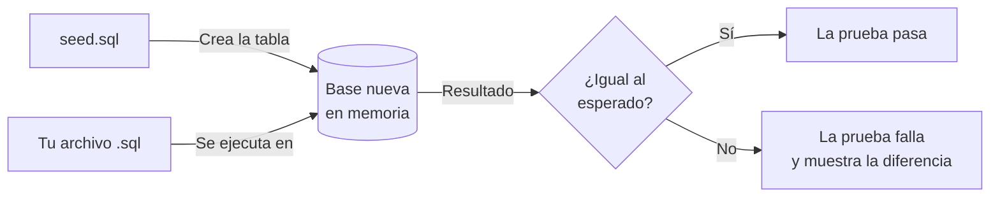

# 🧩 1.2 · Primeras consultas

| ⏱️ Duración | 🧪 Tipo | 🏷️ Tipo de tema | 🛠️ Stack |
|---|---|---|---|
| 1–2 h | 🧩 `challenge` | 🎯 `core` | Python 3.12+ · `sqlite3` (SQLite 3.45+) · pytest 9.2.0 |

## 🎯 Objetivos
- Elegir las columnas que pide un reporte, en el orden pedido, con `SELECT … FROM`.
- Calcular columnas nuevas con operaciones aritméticas y paréntesis.
- Darle un nombre claro a una columna calculada con `AS`, y redondearla con `ROUND`.
- Correr las pruebas del curso con `python -m pytest` y leer un fallo para saber qué corregir.
- Reconocer los tropiezos típicos de las primeras consultas, los mismos que salen en las entrevistas.

## 💡 Por qué importa
En el lab 1.1 pediste todas las columnas con `SELECT *`. En un trabajo casi nunca quieres todo: un reporte pide ciertas columnas, a veces calculadas (una ganancia, un precio con impuesto), y con nombres claros. Además necesitas saber si tu consulta devuelve justo lo que te pidieron, sin revisar fila por fila a ojo. Para eso están las pruebas automáticas, que usarás en todos los retos del curso.

## 📍 Dónde correr los comandos
Con el entorno virtual activo (paso 2 de [SETUP.md](../../../SETUP.md)), entra a la carpeta `starter/` de este lab. Todos los comandos del lab se corren desde ahí.

PowerShell o Bash, desde la raíz del repositorio:

```bash
cd labs/01-query-a-table/02-first-queries/starter
```

Si la salida de `python -m pytest` tiene una línea que empieza con `plugins:`, o termina con algo como `3 warnings`, no estás usando el Python del entorno, aunque el prompt diga `(.venv)`: sigue el [paso 3 de SETUP.md](../../../SETUP.md#3-comprueba-todo).

## 🧠 Conceptos
Los ejemplos usan la tabla `jobs` de la bolsa de trabajo del [lab 1.1](../01-first-database/README.md), con sus columnas `title`, `city` y `salary_usd` (el sueldo mensual en dólares). Cada resultado muestra sus primeras filas.

### Elegir columnas: la lista del `SELECT` (*select list*)
Para publicar un listado de ofertas con su ciudad no te sirven las siete columnas de `jobs`, solo dos. En lugar del `*`, escribe después de `SELECT` los nombres de las columnas que quieres, separados por comas:

```sql
SELECT title, city
FROM jobs;
```

| title | city |
|---|---|
| Analista de datos júnior | Lima |
| Desarrollador backend | Bogotá |
| Soporte de TI | Arequipa |

Las columnas salen en el orden en que las escribes, no en el de la tabla. Esa lista de columnas se llama *select list* (la lista del `SELECT`). Una consulta puede ocupar varias líneas: el `;` marca el final, como viste en el lab 1.1.

### Calcular columnas nuevas (*expression*)
La tabla guarda el sueldo mensual, pero te piden el anual. No tienes que agregar una columna a la tabla: en la lista del `SELECT` puedes escribir un cálculo con columnas y números, y el motor lo hace para cada fila.

```sql
SELECT title, salary_usd * 12
FROM jobs;
```

| title | salary_usd * 12 |
|---|---|
| Analista de datos júnior | 14400 |
| Desarrollador backend | 21600 |
| Soporte de TI | 9600 |

Un cálculo así se llama **expresión** (*expression*). Los operadores son los de una calculadora: `+`, `-`, `*` (multiplicar) y `/` (dividir). Como en matemáticas, `*` y `/` se hacen antes que `+` y `-`, y los paréntesis cambian ese orden: `(salary_usd + 200) * 12` suma un bono de 200 al mes y después multiplica por 12. El cálculo vive solo en el resultado; la tabla no cambia.

### Ponerle nombre a una columna (*alias*)
Mira el encabezado de la segunda columna de arriba: se llama `salary_usd * 12`, el texto exacto que escribiste. Es difícil de leer, y un programa que busca la columna por su nombre, como un reporte o las pruebas de este lab, necesita un nombre fijo. Con `AS` le das el nombre que quieras:

```sql
SELECT title, salary_usd * 12 AS annual_salary_usd
FROM jobs;
```

| title | annual_salary_usd |
|---|---|
| Analista de datos júnior | 14400 |
| Desarrollador backend | 21600 |
| Soporte de TI | 9600 |

Ese nombre nuevo se llama **alias**. En el curso los alias siguen el mismo estilo que las columnas de las tablas: en inglés, en minúsculas y con `_` en lugar de espacios.

### Redondear (*`ROUND`*)
Con un tipo de cambio de 3.7413 soles por dólar, el primer sueldo de `jobs` es 1200 × 3.7413 = 4489.56 soles, y quieres mostrarlo con un solo decimal. `ROUND(valor, decimales)` redondea un número a esa cantidad de decimales:

```sql
SELECT title, ROUND(salary_usd * 3.7413, 1) AS salary_pen
FROM jobs;
```

| title | salary_pen |
|---|---|
| Analista de datos júnior | 4489.6 |
| Desarrollador backend | 6734.3 |
| Soporte de TI | 2993.0 |

`ROUND` es una **función** (*function*): recibe valores entre paréntesis y devuelve otro. Siempre devuelve un número con decimales (`REAL`), por eso 2993.04 queda como `2993.0`. Si no le das la cantidad de decimales, redondea al entero. En el lab 1.6 verás muchas funciones más.

### Una prueba revisa tu consulta por ti (*test*)
Con 8 filas puedes comprobar un resultado a ojo; con 8000, o cada vez que cambias la consulta, ya no. Una **prueba automática** (*test*) es un programa que corre tu consulta sobre datos conocidos y compara lo que devuelve con el resultado esperado. Si coinciden, la prueba **pasa** (*pass*, se dice que está "en verde"); si no, **falla** (*fail*, "en rojo") y te muestra la diferencia.

En el curso las pruebas están escritas con **pytest**, una herramienta de Python, y las corres con `python -m pytest`. Tú no escribes pruebas: escribes la consulta, corres las pruebas y lees qué dicen. Cómo lo hacen en este lab está en el escenario.

## 📚 Documentación
- [SQLite: `SELECT`, la lista de columnas del resultado](https://www.sqlite.org/lang_select.html#resultset)
- [SQLite: operadores y su orden](https://www.sqlite.org/lang_expr.html#binaryops)
- [SQLite: la función `round`](https://www.sqlite.org/lang_corefunc.html#round)
- [pytest: cómo correr las pruebas y elegir cuáles](https://docs.pytest.org/en/stable/how-to/usage.html#specifying-which-tests-to-run)

## 🧭 Escenario
Una cafetería guarda su carta en una base SQLite y te pide cuatro consultas para sus reportes. Cada consulta va en su propio archivo `.sql`, y las pruebas te dicen si está bien.

### La carta de la cafetería
La tabla `menu_items` tiene una fila por producto. Los precios están en soles y **sin impuesto**; `cost` es lo que le cuesta a la cafetería preparar cada producto.

| Columna | Tipo | Qué guarda |
|---|---|---|
| `id` | `INTEGER` | El número que identifica al producto |
| `name` | `TEXT` | El nombre del producto |
| `category` | `TEXT` | `bebida`, `comida` o `postre` |
| `price` | `REAL` | El precio de venta, sin impuesto |
| `cost` | `REAL` | El costo de prepararlo |

Estos son todos sus datos:

| id | name | category | price | cost |
|---|---|---|---|---|
| 1 | Café americano | bebida | 6.0 | 1.5 |
| 2 | Capuchino | bebida | 8.5 | 2.25 |
| 3 | Té de manzanilla | bebida | 5.0 | 0.75 |
| 4 | Jugo de naranja | bebida | 9.5 | 3.5 |
| 5 | Sándwich de pollo | comida | 14.0 | 6.25 |
| 6 | Empanada de carne | comida | 7.5 | 3.0 |
| 7 | Torta de chocolate | postre | 11.0 | 4.5 |
| 8 | Alfajor | postre | 3.7 | 1.25 |

### Tus archivos
```text
starter/
├── queries/             tus cuatro consultas, una por tarea
│   ├── 01_menu.sql
│   ├── 02_profit.sql
│   ├── 03_price_with_tax.sql
│   └── 04_margin.sql
├── seed.sql             crea la tabla y sus 8 filas
├── tests/
│   ├── conftest.py      prepara la base y compara resultados
│   └── test_queries.py  las pruebas: una clase por tarea
└── pyproject.toml       le dice a pytest dónde están las pruebas
```

- Solo cambias los archivos de [`queries/`](starter/queries/). Cada uno trae una línea que empieza con `--`: es un **comentario**, una nota que SQL ignora hasta el final de la línea. Escribe tu consulta debajo del comentario, o bórralo; da igual. Cada archivo lleva **una sola** consulta.
- [`seed.sql`](starter/seed.sql) tiene los datos de la tabla de arriba. No lo cambies. Usa `CREATE TABLE` e `INSERT`, que aprenderás en el bloque 3.
- [`tests/`](starter/tests/test_queries.py) y [`pyproject.toml`](starter/pyproject.toml) son de las pruebas; no necesitas cambiarlos. Al correr las pruebas, pytest crea las carpetas `.pytest_cache` y `tests/__pycache__`. Git las ignora; puedes dejarlas ahí.

### Cómo se revisa tu trabajo
Cada prueba arma desde cero una **base de datos en memoria** (*in-memory database*): una base que vive solo mientras corre la prueba y no crea ningún archivo. Le carga los datos de `seed.sql`, ejecuta uno de tus archivos y compara su resultado con el esperado.



La comparación revisa dos cosas: primero las **columnas**, su nombre y su orden; después las **filas**, con sus valores exactos y en cualquier orden. Según lo que encuentre, el fallo empieza con uno de estos mensajes:

| El fallo empieza con… | Qué significa |
|---|---|
| `tu archivo no devolvió ningún resultado` | El archivo no tiene una consulta: sigue con el comentario del `TODO` |
| `tu consulta dio un error` | SQLite no pudo ejecutarla; la línea siguiente dice por qué |
| `las columnas no coinciden` | Muestra las columnas esperadas, las tuyas y tus primeras filas |
| `las columnas están bien, pero las filas no coinciden` | Muestra las filas esperadas que no salieron y las tuyas que no se esperaban |

Las filas se muestran como en la consola del lab 1.1: cada una como una tupla de Python, con los textos entre comillas.

Cuando SQLite no puede ejecutar tu consulta, la línea siguiente copia su mensaje, que está en inglés. Los dos más comunes:
- `near "FROM": syntax error` (*error de sintaxis cerca de `FROM`*): SQLite se perdió al llegar a `FROM`, así que el problema suele estar justo antes, como una coma de más al final de la lista del `SELECT`.
- `no such column: nmae` (*no existe la columna `nmae`*): `nmae` no es una columna de la tabla. Revisa cómo la escribiste.

[`TestSeed`](starter/tests/test_queries.py) es una prueba de guarda: pasa desde el comienzo y solo falla si alguien cambió `seed.sql`.

## ✅ Tareas

Corre todas las pruebas con este comando, desde `starter/`:

PowerShell o Bash:

```bash
python -m pytest
```

Córrelo ahora, antes de escribir nada: pasa 1 prueba y fallan 4, una por tarea. En la sección 👀 Qué deberías ver, más abajo, aprendes a leer esa salida.

### Tarea 1 · La carta
**Objetivo:** el nombre, la categoría y el precio de cada producto, en ese orden: columnas `name`, `category` y `price`. **Lo valida:** [`TestTask1Menu`](starter/tests/test_queries.py)

🔮 **Predict first:** en el lab 1.1 escribiste `'jobs'` entre comillas simples dentro de `pragma_table_info('jobs')`. ¿Qué crees que pasa si escribes el nombre de una columna entre comillas simples? Escribe tu predicción y después pon esta consulta en [`queries/01_menu.sql`](starter/queries/01_menu.sql):

```sql
SELECT 'name', category, price
FROM menu_items;
```

- [ ] Corre las pruebas y busca lo que dicen de `TestTask1Menu`. Compáralo con tu predicción.
- [ ] Deja en el archivo una consulta que devuelva lo que pide la tarea, y vuelve a correr las pruebas hasta que `TestTask1Menu` pase.

**Criterio de éxito:** `TestTask1Menu` pasa: 2 pruebas pasan y 3 fallan.

### Tarea 2 · La ganancia de cada producto
**Objetivo:** el nombre y la ganancia de cada producto, es decir, su precio menos su costo: columnas `name` y `profit`. **Lo valida:** [`TestTask2Profit`](starter/tests/test_queries.py)

🔮 **Predict first:** es fácil olvidar una coma en la lista del `SELECT`. ¿Qué crees que hará SQLite con esta consulta, a la que le falta la coma entre `name` y `price`: dar un error, o algo distinto? Escribe tu predicción y después ponla en [`queries/02_profit.sql`](starter/queries/02_profit.sql):

```sql
SELECT name price
FROM menu_items;
```

- [ ] Corre solo la prueba de esta tarea con `python -m pytest -k task2`. `-k` elige las pruebas cuyo nombre contiene ese texto; la última línea dice `1 failed, 4 deselected`, es decir, 1 falló y 4 no se eligieron. Lee lo que muestra y compáralo con tu predicción.
- [ ] Reemplaza la consulta de la predicción por la de la tarea, con la resta y su alias, y vuelve a correr `python -m pytest -k task2`.

**Criterio de éxito:** `TestTask2Profit` pasa. Con todas las pruebas (`python -m pytest`), 3 pasan y 2 fallan.

### Tarea 3 · El precio con impuesto
**Objetivo:** el nombre y el precio final de cada producto, con el 18 % de impuesto incluido y redondeado a dos decimales (céntimos): columnas `name` y `price_with_tax`. Sumar el 18 % es lo mismo que multiplicar por 1.18. **Lo valida:** [`TestTask3PriceWithTax`](starter/tests/test_queries.py)

🔮 **Predict first:** los precios tienen a lo más un decimal (5.0, 9.5…) y 1.18 tiene dos, así que el resultado tiene a lo más tres. ¿Pasará la prueba si todavía no redondeas? Escribe tu predicción y después pon esta consulta en [`queries/03_price_with_tax.sql`](starter/queries/03_price_with_tax.sql):

```sql
SELECT name, price * 1.18 AS price_with_tax
FROM menu_items;
```

- [ ] Corre `python -m pytest -k task3`, lee lo que muestra fila por fila y compáralo con tu predicción.
- [ ] Deja en el archivo una consulta que devuelva el precio final como lo pide la tarea, y vuelve a correr `python -m pytest -k task3` hasta que la prueba pase.

**Criterio de éxito:** `TestTask3PriceWithTax` pasa. Con todas las pruebas, 4 pasan y 1 falla.

### Tarea 4 · El margen
**Objetivo:** el nombre y el margen de cada producto: qué porcentaje del precio es ganancia, redondeado a un decimal. Columnas `name` y `margin_pct`. **Lo valida:** [`TestTask4Margin`](starter/tests/test_queries.py)

El margen es la ganancia dividida entre el precio, por 100. Por ejemplo, un producto que se vende a 10 soles y cuesta 4 deja una ganancia de 6, y su margen es 6 / 10 × 100 = 60 %.

🔮 **Predict first:** en la tarea 2 llamaste `profit` a la ganancia. ¿Puedes usar ese alias en otra columna de la misma consulta? Escribe tu predicción y después pon esta consulta en [`queries/04_margin.sql`](starter/queries/04_margin.sql):

```sql
SELECT name, price - cost AS profit, ROUND(profit * 100 / price, 1) AS margin_pct
FROM menu_items;
```

- [ ] Corre `python -m pytest -k task4` y compara lo que muestra con tu predicción.
- [ ] Reemplaza la consulta de la predicción por la de la tarea, solo con las columnas `name` y `margin_pct`, y vuelve a correr `python -m pytest -k task4`. Si te salen márgenes negativos, revisa en qué orden se hacen las operaciones.
- [ ] Corre todas las pruebas con `python -m pytest -v`: `-v` muestra una línea por prueba, con su nombre y `PASSED` o `FAILED`.

**Criterio de éxito:** `TestTask4Margin` pasa: las 5 pruebas pasan.

## 🔍 Command dissection
| Parte | Qué hace |
|---|---|
| `SELECT a, b FROM t;` | Devuelve las columnas `a` y `b` de todas las filas de `t`, en ese orden |
| `+` · `-` · `*` · `/` | Suma, resta, multiplicación y división; `*` y `/` van antes que `+` y `-` |
| `( … )` | Calcula primero lo que está adentro |
| `<expresión> AS <nombre>` | Le da un nombre a la columna del resultado; sin `AS`, la columna se llama como el texto de la expresión |
| `ROUND(x, n)` | Redondea `x` a `n` decimales; sin `n`, al entero. Devuelve `REAL` |
| `-- texto` | Comentario: SQL ignora desde `--` hasta el final de la línea |
| `python -m pytest` | Corre todas las pruebas de la carpeta; `pyproject.toml` le dice dónde están |
| `python -m pytest -k task1` | Corre solo las pruebas cuyo nombre contiene `task1`, sin distinguir mayúsculas |
| `python -m pytest -v` | Muestra una línea por prueba, con `PASSED` o `FAILED` |

## 👀 Qué deberías ver
Así se ve la salida antes de escribir nada, recortada a las partes que importan (`…` marca lo que se quitó). Las líneas de `=` y `_` se ajustan al ancho de tu terminal:

```text
============================= test session starts =============================
platform win32 -- Python 3.12.16, pytest-9.2.0, pluggy-1.7.0
…
configfile: pyproject.toml
testpaths: tests
collected 5 items

tests\test_queries.py .FFFF                                              [100%]

================================== FAILURES ===================================
_________________ TestTask1Menu.test_name_category_and_price __________________
01_menu.sql: tu archivo no devolvió ningún resultado (¿todavía tiene solo el TODO?).
  Columnas esperadas: name, category, price
____________________ TestTask2Profit.test_profit_per_item _____________________
02_profit.sql: tu archivo no devolvió ningún resultado (¿todavía tiene solo el TODO?).
  Columnas esperadas: name, profit
…
=========================== short test summary info ===========================
FAILED tests/test_queries.py::TestTask1Menu::test_name_category_and_price - F...
…
========================= 4 failed, 1 passed in 0.02s =========================
```

Léela de arriba abajo:

1. **El encabezado:** qué Python y qué pytest corren (tu versión puede ser otra), qué archivo de configuración leyó pytest (`pyproject.toml`) y dónde buscó las pruebas (`tests`). `collected 5 items` dice que encontró 5 pruebas: la guarda y una por tarea.
2. **`.FFFF`:** un carácter por prueba, en orden. `.` es una prueba que pasó (la guarda) y `F` una que falló (*failed*).
3. **`FAILURES`:** un bloque por cada prueba que falló. El título dice qué prueba es (`TestTask1Menu…`, la de la tarea 1), y debajo viene el mensaje: qué archivo revisó y qué encontró. **Aquí está lo que tienes que corregir.**
4. **`short test summary info`:** la lista de las pruebas que fallaron, una por línea. En una terminal angosta el final de la línea se corta (`- F...`); el detalle completo está arriba, en `FAILURES`.
5. **La última línea** cuenta cuántas pruebas fallaron y cuántas pasaron. Cuando todo pasa, dice `5 passed` y no hay sección `FAILURES`.

## 💼 En proyectos reales
- **El dinero no se guarda en `REAL`.** Para montos de dinero, PostgreSQL y MySQL tienen un tipo decimal exacto, `NUMERIC` o `DECIMAL`, que su documentación recomienda para montos ([PostgreSQL](https://www.postgresql.org/docs/current/datatype-numeric.html#DATATYPE-NUMERIC-DECIMAL), [MySQL](https://dev.mysql.com/doc/refman/8.4/en/fixed-point-types.html)). SQLite no tiene uno: guarda los números con decimales como `REAL` ([sus tipos](https://www.sqlite.org/datatype3.html)). Allí una alternativa es guardar los montos como enteros, en céntimos. `ROUND` sirve para mostrar un resultado, no para arreglar cómo se guardan los datos.
- **En el código de una aplicación se evita `SELECT *`.** Si alguien agrega una columna a la tabla, el resultado de tu consulta cambia sin que la toques. `*` está bien para explorar una tabla, como en el lab 1.1.
- **Los alias son parte del contrato.** Un reporte, un tablero o el código que lee tu consulta buscan las columnas por su nombre. Cambiar un alias puede romper a quien lo usa, igual que cambiar el nombre de una columna.

## 🆘 Pistas
<details><summary>Pista 1 · Las columnas no coinciden</summary>

Lee las dos líneas `Esperadas:` y `Obtenidas:` del fallo. El nombre y el orden de tus columnas tienen que ser exactamente los esperados. Si la columna que falta es calculada, ¿le pusiste su alias?
</details>

<details><summary>Pista 2 · Redondear un cálculo</summary>

`ROUND` envuelve el cálculo completo: primero va el cálculo y después, separada por una coma, la cantidad de decimales. El alias va después del paréntesis que cierra `ROUND`.
</details>

<details><summary>Pista 3 · El margen</summary>

No puedes usar el alias `profit`, pero sí puedes repetir la resta. Usa paréntesis para que la resta se haga antes que la multiplicación: `(price - cost) * 100 / price`, y redondea todo eso a un decimal.
</details>

## ✔️ Respuestas verificadas
<details><summary>Abre esta sección solo después de terminar las tareas</summary>

Verificado en Windows 11, en PowerShell 5.1 y Git Bash, con Python 3.12.16, 3.13.14, 3.13.18, 3.14.4 y 3.15.2 (SQLite 3.50.4 y 3.53.1) y con Python 3.12.7 de Anaconda (SQLite 3.45.3). La salida fue la misma en todas las versiones.

### Tarea 1 · Un nombre entre comillas simples es un texto
```text
01_menu.sql: las columnas no coinciden (importan el nombre y el orden).
  Esperadas: name, category, price
  Obtenidas: 'name', category, price
  Tus primeras filas:
    ('name', 'bebida', 6.0)
    ('name', 'bebida', 8.5)
    ('name', 'bebida', 5.0)
```

Sin error, pero la primera columna dice `name` en todas las filas. **Las comillas simples escriben un valor de texto** (un *literal*), no el nombre de una columna: `'name'` es la palabra "name", y SQLite la repite en cada fila. En `pragma_table_info('jobs')` las comillas estaban bien porque ahí se pasa el nombre de la tabla como un texto. Los nombres de columnas se escriben sin comillas: `SELECT name, category, price FROM menu_items;`.

El SQL estándar usa comillas dobles para nombres (`"name"` es la columna) y simples para textos. SQLite tiene una excepción: si escribes mal un nombre entre comillas dobles, como `"nmae"`, no da error y lo toma como el texto `'nmae'` ([es una rareza conocida de SQLite](https://www.sqlite.org/quirks.html#dblquote)). Las pruebas del curso apagan esa excepción, así que ahí `"nmae"` o `"Lima"` dan `no such column`; la consola `python -m sqlite3` la mantiene. Por eso, mejor nombres sin comillas y textos siempre entre comillas simples.

### Tarea 2 · Una coma olvidada crea un alias
```text
02_profit.sql: las columnas no coinciden (importan el nombre y el orden).
  Esperadas: name, profit
  Obtenidas: price
  Tus primeras filas:
    ('Café americano',)
    ('Capuchino',)
    ('Té de manzanilla',)
```

Sin error, y con una sola columna: se llama `price`, pero tiene los nombres de los productos. **En SQL, `AS` es opcional:** `name price` significa `name AS price`, la columna `name` con el alias `price`. Por eso una coma olvidada no da error, sino un resultado con nombres equivocados. Es una pregunta frecuente de entrevista, y una buena razón para escribir siempre `AS`.

La consulta de la tarea es `SELECT name, price - cost AS profit FROM menu_items;`. Sin el alias, la prueba dice `Obtenidas: name, price - cost`.

### Tarea 3 · Los decimales de una computadora no son exactos
```text
03_price_with_tax.sql: las columnas están bien, pero las filas no coinciden (el orden de las filas no importa).
  Filas esperadas: 8; obtenidas: 8
  Esperadas que no salieron:
    ('Té de manzanilla', 5.9)
    ('Jugo de naranja', 11.21)
    ('Torta de chocolate', 12.98)
    ('Alfajor', 4.37)
  Obtenidas que no se esperaban:
    ('Té de manzanilla', 5.8999999999999995)
    ('Jugo de naranja', 11.209999999999999)
    ('Torta de chocolate', 12.979999999999999)
    ('Alfajor', 4.366)
```

Fallan cuatro filas, por dos razones distintas; las otras cuatro salieron bien. El alfajor da 3.7 × 1.18 = 4.366, un resultado correcto con tres decimales de verdad, y la tarea pide céntimos: hay que redondearlo a 4.37. Las otras tres son más raras: 5 × 1.18 debería dar 5.9, y da 5.8999999999999995. **Un `REAL` guarda los números en binario, y la mayoría de los decimales, como 1.18, no tienen una forma exacta en binario**, igual que 1/3 no tiene una forma exacta en decimal (0.333…). La diferencia es mínima, pero basta para que 5.8999999999999995 no sea igual a 5.9. No es un error de SQLite: Python da lo mismo con `5.0 * 1.18`, y la [documentación de Python](https://docs.python.org/es/3/tutorial/floatingpoint.html) lo explica en detalle.

`ROUND` arregla las cuatro filas para mostrar el resultado: `SELECT name, ROUND(price * 1.18, 2) AS price_with_tax FROM menu_items;`. Redondear a tres decimales o más no basta, porque el alfajor sigue saliendo 4.366. El precio del té sale `5.9` y no `5.90` porque un número no guarda ceros a la derecha; darle formato a un número es otro tema.

### Tarea 4 · Un alias no existe dentro de su propio `SELECT`
```text
04_margin.sql: tu consulta dio un error.
  OperationalError: no such column: profit
```

*no such column* (no existe la columna): **el alias le pone nombre a una columna del resultado, y el resultado todavía no existe mientras se calculan sus columnas.** Por eso `profit` no se puede usar en otra columna del mismo `SELECT`, y hay que repetir el cálculo: `SELECT name, ROUND((price - cost) * 100 / price, 1) AS margin_pct FROM menu_items;`. Sin los paréntesis, `price - cost * 100 / price` multiplica y divide `cost` antes de restar, y da márgenes negativos. En el bloque 4 aprenderás a escribir un cálculo una vez y reusarlo.
</details>

## 🎤 Autoevaluación
1. Un compañero dice que `SELECT *` "es más fácil y trae lo mismo". ¿En qué casos le darías la razón y en cuáles no?
2. En una entrevista te muestran `SELECT name category FROM products;` y te preguntan qué devuelve. ¿Qué respondes?
3. ¿Qué devuelve `SELECT 'price' FROM products;` en una tabla de 3 filas, y por qué?
4. Una consulta de facturación suma `0.1 + 0.2` y el total no es igual a `0.3`. ¿Por qué pasa, y cómo lo evitarías al guardar montos de dinero?
5. Quieres el precio con impuesto y, en otra columna, ese mismo precio por 2. ¿Por qué falla `SELECT price * 1.18 AS final, final * 2 FROM products;`, y cómo lo escribes para que funcione?

<details><summary>Respuestas</summary>

1. Para explorar una tabla que no conoces, `*` está bien. En un reporte o en el código de una aplicación, no: trae columnas que nadie pidió, y si la tabla gana una columna, tu resultado cambia sin que toques la consulta.
2. Una sola columna, llamada `category`, con los nombres de los productos: falta una coma, y como `AS` es opcional, `category` queda como alias de `name`. No da error.
3. Tres filas con el texto `price`: las comillas simples escriben un texto, no el nombre de una columna. La columna se llama `'price'`.
4. Los números con decimales se guardan en binario, y 0.1 y 0.2 no tienen una forma exacta en binario: la suma da 0.30000000000000004. Para dinero se usa un tipo decimal exacto (`NUMERIC` o `DECIMAL` en PostgreSQL y MySQL) o enteros en céntimos.
5. Porque el alias `final` nombra una columna del resultado, y no existe mientras se calcula el mismo `SELECT`: SQLite responde `no such column: final`. Se repite el cálculo: `SELECT price * 1.18 AS final, price * 1.18 * 2 AS double_final FROM products;`.
</details>

La solución completa está en [`solution/`](solution/).

## 🔁 Retrospectiva
- ¿Qué entendí?
- ¿Qué me costó?
- ¿Qué debería reforzar?
