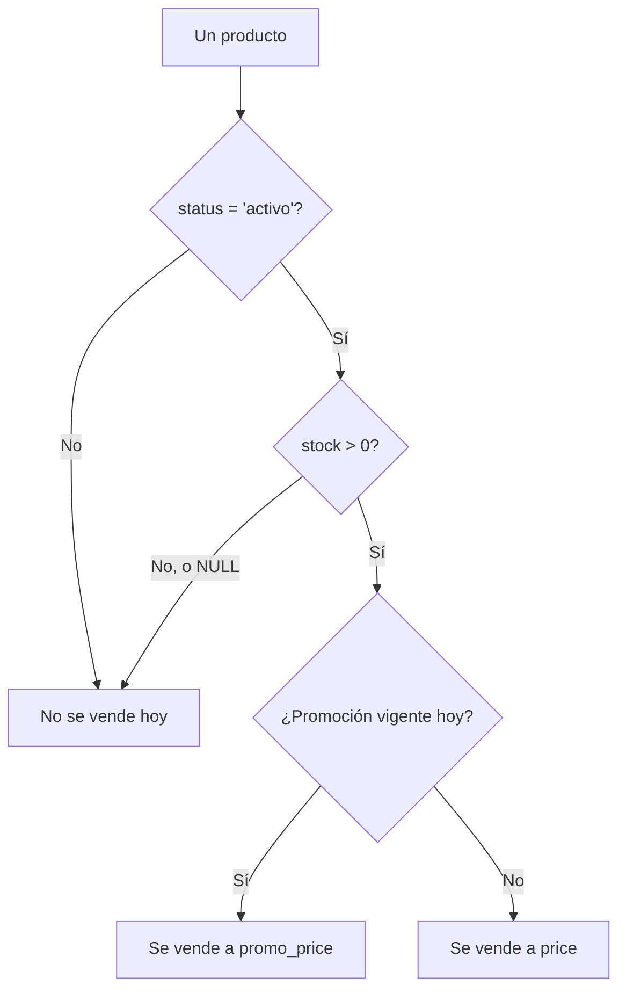

# 📋 Brief · Catálogo de una tienda

## La pregunta del dominio
> ¿Qué puede comprar hoy un cliente, y a qué precio?

Todas las preguntas del equipo de ventas salen de esta. Un producto que no se puede vender no debe aparecer donde lo ve un cliente, y un precio de promoción vencida no debe cobrarse.

## Contexto
Conecta es una tienda en línea de tecnología en Lima. Su catálogo vive en una sola tabla, `products`, que llenan a mano el equipo de compras y los proveedores. Por eso trae lo que trae cualquier tabla real: marcas escritas de varias formas, datos que faltan y promociones que ya vencieron.

El equipo de ventas te hace seis preguntas. Respondes cada una con **una consulta** en un archivo `.sql`, y las pruebas de [`acceptance/`](acceptance/) las corren contra los datos de la tienda.

**Hoy es el 20 de noviembre de 2026** en todas las preguntas. Escríbelo como texto, `'2026-11-20'`: así las respuestas no cambian según el día en que corras las pruebas.

## Dominio

### Las reglas
| Regla | Qué significa |
|---|---|
| **Se puede vender hoy** | `status` es `'activo'` **y** hay stock: `stock` mayor que 0. Si nadie contó el stock (`NULL`), no se vende: no sabemos si hay. |
| **Promoción vigente** | Tiene `promo_price` y su último día, `promo_ends`, es hoy o después. Si `promo_ends` es `NULL`, la promoción no tiene fecha de fin y sigue vigente. |
| **Precio final** | `promo_price` si la promoción está vigente; si no, `price`. |
| **Categoría** | Un producto sin categoría (`NULL` o texto vacío `''`) se muestra como `'Otros'`. |
| **Marca** | Cada proveedor la escribió a su manera (`'Sony'`, `'sony '`): para compararlas, en minúsculas y sin espacios al comienzo ni al final. |

### La tabla `products`
| Columna | Tipo | Qué guarda |
|---|---|---|
| `id` | `INTEGER` | El número del producto |
| `name` | `TEXT` | El nombre, como lo ve el cliente |
| `brand` | `TEXT` | La marca, tal como la escribió el proveedor; `NULL` si no tiene marca |
| `category` | `TEXT` | La categoría; `NULL` o `''` si nadie la puso |
| `price` | `REAL` | El precio de lista, en soles |
| `promo_price` | `REAL` | El precio durante la promoción; `NULL` si no tiene promoción |
| `promo_ends` | `TEXT` | El último día de la promoción, `'AAAA-MM-DD'`; `NULL` si no tiene fecha de fin |
| `stock` | `INTEGER` | Las unidades en el almacén; `NULL` si nadie las contó |
| `status` | `TEXT` | `'activo'`, `'pausado'` o `'descontinuado'` |
| `added_at` | `TEXT` | Cuándo entró al catálogo, `'AAAA-MM-DD HH:MM'` |

Estos son todos sus datos (los crea [`acceptance/seed.sql`](acceptance/seed.sql)). Las marcas van entre comillas para que se vean sus espacios:

| id | name | brand | category | price | promo_price | promo_ends | stock | status | added_at |
|---|---|---|---|---|---|---|---|---|---|
| 1 | Audífonos Bluetooth AX2 | `'Sony'` | Audio | 199.9 | 149.9 | 2026-11-30 | 12 | activo | 2026-06-10 11:00 |
| 2 | Parlante portátil bluetooth | `'sony '` | Audio | 159.0 | `NULL` | `NULL` | 0 | activo | 2026-11-02 16:30 |
| 3 | Hub USB 4 puertos | `' Anker'` | Accesorios | 79.9 | 69.9 | 2026-11-19 | 3 | activo | 2026-09-15 10:00 |
| 4 | Adaptador USB-C a HDMI | `'Anker'` | Accesorios | 79.9 | `NULL` | `NULL` | 40 | activo | 2026-10-21 09:00 |
| 5 | Memoria USB 64 GB | `'Kingston'` | Accesorios | 39.9 | 34.9 | 2026-11-20 | 25 | pausado | 2026-11-10 12:00 |
| 6 | Mouse inalámbrico M3 | `'Logitech'` | Cómputo | 89.9 | 79.9 | `NULL` | 8 | activo | 2026-11-12 18:40 |
| 7 | Teclado mecánico K8 | `'LOGITECH'` | Cómputo | 249.0 | `NULL` | `NULL` | 6 | activo | 2026-10-20 23:00 |
| 8 | Monitor 24 pulgadas | `'Samsung'` | Cómputo | 649.0 | 577.0 | 2026-12-15 | `NULL` | activo | 2026-08-01 09:30 |
| 9 | Laptop 14 Ryzen 5 | `'Lenovo'` | Cómputo | 2499.0 | `NULL` | `NULL` | 2 | activo | 2026-07-20 15:00 |
| 10 | Funda para laptop 14 | `NULL` | `''` | 49.9 | `NULL` | `NULL` | 15 | activo | 2026-11-20 10:15 |
| 11 | Soporte para celular | `NULL` | `NULL` | 24.9 | 19.9 | 2026-11-25 | 30 | activo | 2026-11-05 08:00 |
| 12 | Cargador rápido 20 W | `'Xiaomi'` | Celulares | 59.9 | `NULL` | `NULL` | 0 | activo | 2026-05-02 10:00 |
| 13 | Celular Redmi 13 | `'xiaomi'` | Celulares | 899.0 | 849.0 | 2026-11-20 | 5 | activo | 2026-09-01 11:00 |
| 14 | Smartwatch Band 9 | `'Xiaomi '` | Celulares | 179.0 | `NULL` | `NULL` | 4 | activo | 2026-11-16 20:00 |
| 15 | Cámara web HD | `'Logitech'` | Cómputo | 159.9 | 129.9 | 2026-12-31 | `NULL` | descontinuado | 2026-03-03 10:00 |
| 16 | Lámpara LED USB | `'Philips'` | Hogar | 34.9 | `NULL` | `NULL` | 9 | activo | 2026-04-18 13:00 |
| 17 | Audífonos con cable | `'Sony'` | Audio | 159.0 | `NULL` | `NULL` | 20 | activo | 2026-02-14 10:00 |

## Contrato
Tu entrega es una carpeta `my-queries/`, junto a `acceptance/` y `reference/`, con **seis archivos `.sql` de una sola consulta cada uno**, con estos nombres exactos. Las columnas se comparan por nombre y en este orden, y las filas, también en el orden pedido.

| Archivo | La pregunta del equipo de ventas | Columnas | Orden |
|---|---|---|---|
| `01_search.sql` | Un cliente busca «usb» o «bluetooth»: los productos que se pueden vender hoy cuyo nombre menciona `usb` o `bluetooth`, en mayúsculas o minúsculas, en cualquier parte del nombre | `id`, `name` | Por `name`, de la A a la Z |
| `02_brands.sql` | Las marcas que vendemos hoy: la marca de cada producto que se puede vender hoy, en minúsculas y sin espacios al comienzo ni al final, cada una una sola vez. Los productos sin marca no cuentan | `brand` | De la A a la Z |
| `03_restock.sql` | Qué reponer: los productos `'activo'` con menos de 5 unidades o con el stock sin contar. `stock_status` dice `'agotado'` si el stock es 0, `'bajo'` si es de 1 a 4, y `'sin contar'` si es `NULL` | `id`, `name`, `stock`, `stock_status` | De menos a más stock (los agotados primero) y los sin contar al final; empates por `name` |
| `04_promotions.sql` | Para marketing: todas las promociones vigentes hoy, se pueda vender el producto o no. `discount_pct` es el porcentaje de descuento sobre `price`, redondeado a 1 decimal | `id`, `name`, `price`, `promo_price`, `discount_pct` | De mayor a menor `discount_pct`; empates por `name` |
| `05_new_arrivals.sql` | La sección «Novedades» de la tienda: los productos que se pueden vender hoy y que entraron al catálogo en los últimos 30 días, desde el día que cae 30 días antes de hoy (incluido) hasta hoy, a cualquier hora. La web muestra 3 por página: devuelve **la página 2**. `added_on` es el día en que entró, sin la hora | `id`, `name`, `added_on` | Del más nuevo al más antiguo, por `added_at` |
| `06_catalog.sql` | **La pregunta del dominio:** todo lo que un cliente puede comprar hoy, con su categoría y su precio final | `id`, `name`, `category`, `final_price` | Por `category` de la A a la Z, después por `final_price` de menor a mayor, después por `name` |

Los nombres de las columnas van tal cual, en inglés y en minúsculas, como en los labs. «De la A a la Z» es el orden de `ORDER BY` en SQLite (lab 1.5): ningún texto de este proyecto depende de cómo se ordenan las tildes.

**Contrato de errores:** las pruebas no esperan errores. Si un archivo falta, no tiene una consulta o tiene dos, la prueba de esa pregunta falla con un mensaje en español que dice cuál es el problema (los mensajes son los de los labs; repásalos en [cómo se revisa tu trabajo](../02-first-queries/README.md#cómo-se-revisa-tu-trabajo)).

## Criterios de aceptación
1. **Dado** el catálogo de `seed.sql`, **cuando** corres `01_search.sql`, **entonces** salen solo los productos que se pueden vender hoy y que mencionan `usb` o `bluetooth`, por nombre. → `TestTask1Search`
2. **Dado** el catálogo, **cuando** corres `02_brands.sql`, **entonces** cada marca que se vende hoy sale una sola vez, limpia, de la A a la Z. → `TestTask2Brands`
3. **Dado** el catálogo, **cuando** corres `03_restock.sql`, **entonces** salen los productos activos agotados, con poco stock o sin contar, con su estado y en el orden pedido. → `TestTask3Restock`
4. **Dado** que hoy es el 2026-11-20, **cuando** corres `04_promotions.sql`, **entonces** salen todas las promociones vigentes (también las sin fecha de fin y las que terminan hoy) con su descuento redondeado a 1 decimal, en el orden pedido. → `TestTask4Promotions`
5. **Dado** que hoy es el 2026-11-20, **cuando** corres `05_new_arrivals.sql`, **entonces** sale la página 2 de las novedades vendibles de los últimos 30 días. → `TestTask5NewArrivals`
6. **Dado** que hoy es el 2026-11-20, **cuando** corres `06_catalog.sql`, **entonces** sale todo lo que se puede vender hoy, con `'Otros'` donde falta la categoría y el precio de promoción solo donde la promoción está vigente, en el orden pedido. → `TestTask6Catalog`

## Requisitos no funcionales
| Requisito | Lo enseñó |
|---|---|
| Una sola consulta por archivo, con las columnas nombradas con `AS` | [Lab 1.2](../02-first-queries/README.md) |
| Ningún filtro pierde ni agrega filas por la precedencia de `AND` y `OR` | [Lab 1.3](../03-filter-rows/README.md) |
| Los `NULL` (stock sin contar, promoción sin fin, marca o categoría que falta) siguen las reglas del dominio, no lo que haga la comparación por defecto | [Lab 1.4](../04-null-values/README.md) |
| Todo orden pedido tiene su desempate, y la paginación da siempre las mismas filas | [Lab 1.5](../05-sort-and-paginate/README.md) |
| Las fechas se comparan como texto ISO-8601 sin perder las que tienen hora | [Lab 1.6](../06-transform-values/README.md) |
| Las respuestas no dependen del día en que se corren: hoy es `'2026-11-20'`, escrito en la consulta | Este brief |

## Qué es nuevo aquí
- **Restar días.** El lab 1.6 sumó días con `DATE(fecha, '+7 days')`; el mismo modificador con signo menos resta: `DATE('2026-11-20', '-1 day')` da `'2026-11-19'`. También puedes calcular el día a mano y escribirlo como texto.
- **`DISTINCT` sobre una expresión.** El lab 1.5 usó `DISTINCT` sobre columnas; funciona igual sobre lo que calcula el `SELECT`, como `SELECT DISTINCT UPPER(name)`.
- **Varias reglas en una consulta.** Cada lab tenía una idea por tarea; aquí una consulta junta el filtro de un lab, el `NULL` de otro y el orden de un tercero. Escribe la consulta por partes: primero el `WHERE` y mira qué filas salen, después las columnas calculadas, al final el `ORDER BY`.

## Fijo y libre
- **Fijo:** los nombres de los archivos, las columnas y su orden, el orden de las filas, los datos de `seed.sql` y que hoy es `'2026-11-20'`.
- **A tu elección:** cómo escribes cada consulta. Hay varias formas correctas de casi todo (`IN` u `OR`, `CASE` o `COALESCE`, `NULLS LAST` u otra forma de ordenar los `NULL`); las pruebas solo miran el resultado.

## Fuera de alcance
- **Contar o sumar** («¿cuántos productos hay por categoría?»): las funciones de agregado son del bloque 2.
- **Guardar la regla «se puede vender hoy» una sola vez:** aquí la repites en varias consultas; las vistas y las consultas por pasos llegan más adelante.
- **La fecha real.** `DATE('now')` devuelve el día de hoy, pero entonces las pruebas cambiarían de un día a otro.
- **Arreglar los datos.** Las marcas sucias se limpian al consultar; corregirlas en la tabla (`UPDATE`) es del bloque 3.
