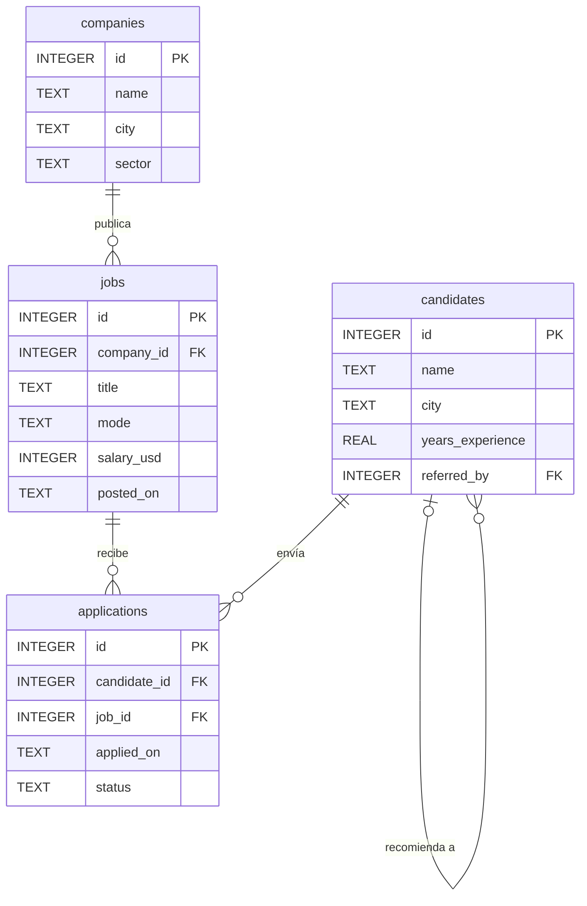

# 🔭 2.1 · Relaciones entre tablas

| ⏱️ Duración | 🧪 Tipo | 🏷️ Tipo de tema | 🛠️ Stack |
|---|---|---|---|
| 1–2 h | 🔭 `exploration` | 🎯 `core` | Python 3.12+ · `sqlite3` (SQLite 3.45+) |

## 🎯 Objetivos
- Explicar por qué una base reparte sus datos en varias tablas en vez de repetirlos en una sola.
- Reconocer la clave primaria de una tabla y las claves foráneas que apuntan a ella.
- Seguir a mano una referencia de una tabla a otra con dos consultas `WHERE`.
- Distinguir una relación uno a muchos de una muchos a muchos, y explicar para qué sirve una tabla intermedia.
- Leer un diagrama entidad-relación: qué tabla apunta a cuál y cuántas filas puede haber de cada lado.

## 💡 Por qué importa
En el bloque 1 cada pregunta se respondía con una sola tabla. En una base real, los datos de una misma pregunta ("¿qué ofertas de empresas de Lima recibieron postulaciones?") están repartidos en varias tablas que se apuntan entre sí. Antes de unirlas con SQL, en el lab 2.2, necesitas saber leer esas relaciones: es lo primero que haces al llegar a una base desconocida en un trabajo, y una pregunta casi segura en las entrevistas.

## 📍 Dónde correr los comandos
Con el entorno virtual activo (el paso 2 de [SETUP.md](../../../SETUP.md)), entra a la carpeta `demo/` de este lab. Todos los comandos se corren desde ahí.

PowerShell o Bash:

```bash
cd labs/02-combine-and-summarize/01-table-relationships/demo
```

## 🧠 Conceptos

### Repetir un dato en muchas filas trae problemas
En el lab 1.1, la tabla `jobs` guardaba el nombre de la empresa en cada oferta:

| id | title | company | city |
|---|---|---|---|
| 1 | Analista de datos júnior | Andes Retail | Lima |
| 4 | Analista de BI | Andes Retail | Lima |

Con dos ofertas no molesta. Pero si Andes Retail publica cincuenta, su nombre y su ciudad se repiten cincuenta veces. Si la empresa se muda, hay que cambiar cincuenta filas, y si se te escapa una, la base dice dos cosas distintas sobre la misma empresa. Si alguien escribe `Andes Retai` en una oferta nueva, para la base es otra empresa. Y no hay dónde guardar una empresa que todavía no publicó ninguna oferta.

La salida es guardar cada cosa **una sola vez, en su propia tabla**: las empresas en `companies`, una fila por empresa, y en cada oferta solo un dato que diga cuál es su empresa. Las reglas para decidir cómo repartir los datos (la normalización) son del lab 3.1; aquí aprendes a leer una base que ya está repartida.

### La clave primaria identifica cada fila (*primary key*)
Para que una oferta diga "mi empresa es esa", cada empresa necesita algo que la identifique sin confusión. El nombre no sirve: dos empresas, o dos personas, pueden llamarse igual, y un nombre puede cambiar. Por eso casi toda tabla tiene una columna `id` con un número distinto en cada fila, que no se reutiliza ni cambia. Esa columna se llama **clave primaria** (*primary key*, a veces abreviada PK). Así se declara al crear la tabla:

```sql
CREATE TABLE companies (
    id   INTEGER PRIMARY KEY,
    name TEXT
);
```

`CREATE TABLE` crea una tabla; lo practicarás en el bloque 3. Por ahora basta con leerlo: `id` es la clave primaria de `companies`.

### La clave foránea apunta a la clave primaria de otra tabla (*foreign key*)
Con las empresas en su tabla, cada oferta guarda el `id` de su empresa en una columna, `company_id`. Una columna que guarda la clave primaria de otra tabla se llama **clave foránea** (*foreign key*, FK): es una referencia, como el número de casillero que te dan en el guardarropa. Al crear la tabla se declara con `REFERENCES`, que dice a qué tabla y columna apunta:

```sql
CREATE TABLE jobs (
    id         INTEGER PRIMARY KEY,
    company_id INTEGER REFERENCES companies (id),
    title      TEXT
);
```

Por costumbre, la clave foránea se llama como la tabla a la que apunta, en singular, más `_id`: `company_id` apunta a `companies`. Es solo una costumbre; lo que manda es el `REFERENCES`. Una clave foránea también puede apuntar a su propia tabla: un postulante que recomendó a otro es otra fila de la misma tabla de postulantes.

### Uno a muchos: la clave foránea va del lado de los muchos (*one-to-many*)
Una empresa publica muchas ofertas, pero cada oferta es de una sola empresa. Esa es una relación **uno a muchos** (*one-to-many*). La clave foránea va en la tabla de los "muchos", `jobs`: cada oferta tiene un solo `company_id`. Al revés no funcionaría, porque una empresa necesitaría una columna por cada oferta que publique.

### Muchos a muchos: una tabla intermedia (*many-to-many*, *join table*)
Un postulante puede postular a muchas ofertas, y una oferta recibe postulaciones de muchas personas. Esa es una relación **muchos a muchos** (*many-to-many*), y no cabe en una sola clave foránea: ni una columna `job_id` en los postulantes ni una `candidate_id` en las ofertas alcanzan, porque cada una guarda un solo valor. La solución es una tercera tabla, la **tabla intermedia** (*join table*), con una fila por cada pareja y una clave foránea hacia cada lado:

| id | candidate_id | job_id |
|---|---|---|
| 1 | 7 | 3 |
| 2 | 7 | 5 |
| 3 | 8 | 3 |

En este ejemplo inventado (no son los datos del lab), la persona 7 postuló a las ofertas 3 y 5, y la oferta 3 recibió a las personas 7 y 8. Una tabla intermedia puede guardar también datos de la pareja, como la fecha de la postulación: un dato que no es ni de la persona ni de la oferta, sino de las dos juntas.

### Un diagrama entidad-relación muestra las tablas y cómo se apuntan (*ER diagram*)
Leer `CREATE TABLE` tras `CREATE TABLE` para entender una base es lento. Un **diagrama entidad-relación** (*entity-relationship diagram*, diagrama ER) dibuja cada tabla como una caja con sus columnas, y cada relación como una línea entre dos cajas. `PK` marca la clave primaria y `FK` las claves foráneas. Los extremos de la línea dicen cuántas filas puede haber de cada lado (la notación se llama "pata de gallo", *crow's foot*):

| Extremo | Se lee |
|---|---|
| `\|\|` (dos rayas) | exactamente una |
| `o\|` (círculo y raya) | cero o una |
| `}o` u `o{` (círculo y pata de gallo) | cero o muchas |
| `}\|` o `\|{` (raya y pata de gallo) | una o muchas |

En el diagrama dibujado, cada extremo aparece como un símbolo pegado a la caja que describe: la pata de gallo es la línea que se abre en tres. Una línea con dos rayas junto a `companies` y un círculo con pata de gallo junto a `jobs` se lee así: cada oferta es de exactamente una empresa, y cada empresa tiene cero o muchas ofertas.

## 📚 Documentación
- [SQLite: la clave primaria en `CREATE TABLE`](https://www.sqlite.org/lang_createtable.html#the_primary_key)
- [SQLite: claves foráneas (*Foreign Key Support*)](https://www.sqlite.org/foreignkeys.html)
- [SQLite: `PRAGMA foreign_key_list`](https://www.sqlite.org/pragma.html#pragma_foreign_key_list), que lista las claves foráneas de una tabla
- [Mermaid: diagramas entidad-relación](https://mermaid.js.org/syntax/entityRelationshipDiagram.html#relationship-syntax), con la tabla completa de extremos

## 🧭 Escenario
La bolsa de trabajo del lab 1.1 creció: ahora guarda las empresas, sus ofertas, los postulantes y cada postulación. En [`demo/`](demo/) está [`build_db.py`](demo/build_db.py), que crea la base `jobs.db` a partir de [`seed.sql`](demo/seed.sql), el archivo con las instrucciones que crean las tablas y les cargan sus filas. Los dos están terminados; no tienes que cambiarlos. Vas a recorrer la base siguiendo sus referencias a mano, que es justo el trabajo que el lab 2.2 le encarga a SQL con `JOIN`.

Este es el diagrama de la base:



`referred_by` es el `id` de la persona que recomendó a ese postulante, o `NULL` si nadie lo recomendó: por eso esa línea empieza en "cero o una".

> [!NOTE]
> [`demo/tests/`](demo/tests/test_build_db.py) comprueba que la base es tal como la describe esta guía, y [`demo/pyproject.toml`](demo/pyproject.toml) le dice a pytest dónde están esas pruebas. No necesitas abrirlos ni cambiarlos.

## 🧪 Experimentos
Antes de cada paso, escribe tu predicción en un papel o en un archivo de notas. Después corre el comando y compara.

Las salidas de los 👀 se verificaron en Windows 11 con Python 3.12.16 y 3.15.2 (SQLite 3.53.1) y con Python 3.12.7 de Anaconda (SQLite 3.45.3), con la misma salida en los tres.

### Experimento 1 · Crear la base y ver sus tablas
PowerShell o Bash:

```bash
python build_db.py
python -m sqlite3 jobs.db
```

La consola es la misma del lab 1.1: escribes después del prompt `sqlite>` y terminas cada instrucción con `;`.

🔮 **Predict first:** el diagrama tiene cuatro cajas. ¿Cuántas filas devolverá esta consulta, y cuáles?

```sql
SELECT name FROM sqlite_schema;
```

<details><summary>👀 Qué deberías ver</summary>

`build_db.py` imprime `Listo: jobs.db creado con 4 tablas.`, y la consulta devuelve una fila por tabla:

```text
('companies',)
('jobs',)
('candidates',)
('applications',)
```

Cuatro tablas, las cuatro cajas del diagrama. Las líneas del diagrama no aparecen como tablas: las relaciones viven dentro de las tablas, en sus claves foráneas.
</details>

### Experimento 2 · ¿De qué empresa es la oferta 4?
Mira la oferta 4:

```sql
SELECT * FROM jobs WHERE id = 4;
```

```text
(4, 1, 'Analista de BI', 'presencial', 1500, '2026-11-10')
```

El segundo valor es su `company_id`: `1`. El nombre de la empresa no está en `jobs`.

🔮 **Predict first:** escribe tú la consulta que te dice el nombre y la ciudad de la empresa de esta oferta, antes de abrir el 👀. ¿En qué tabla buscas, y con qué condición?

<details><summary>👀 Qué deberías ver</summary>

Se busca en `companies` la fila cuya clave primaria es el `company_id` de la oferta:

```sql
SELECT * FROM companies WHERE id = 1;
```

```text
(1, 'Andes Retail', 'Lima', 'retail')
```

**Seguir una clave foránea es buscar su valor en la clave primaria de la otra tabla.** Aquí te tomó dos consultas: una para leer el `company_id` y otra para buscar la empresa. En el lab 2.2, `JOIN` hace los dos pasos en una sola consulta, para todas las filas a la vez.
</details>

### Experimento 3 · Una empresa, muchas ofertas
Para ver las ofertas de Andes Retail no buscas en `companies`, que no tiene ninguna columna de ofertas: buscas en `jobs` las filas que apuntan a ella.

```sql
SELECT id, title FROM jobs WHERE company_id = 1;
```

```text
(1, 'Analista de datos júnior')
(4, 'Analista de BI')
(9, 'Practicante de marketing digital')
```

Tres ofertas apuntan a la misma empresa: el lado de los "muchos" de la relación uno a muchos.

🔮 **Predict first:** Nube Andina es la empresa con `id` 6. Lee en el diagrama la línea entre `companies` y `jobs`: ¿puede una empresa no tener ninguna oferta? ¿Qué devolverá esta consulta?

```sql
SELECT id, title FROM jobs WHERE company_id = 6;
```

<details><summary>👀 Qué deberías ver</summary>

Nada: ni filas ni error. Vuelve a aparecer `sqlite>`.

**Nube Andina existe en `companies`, pero ninguna oferta apunta a ella.** El círculo del extremo `o{`, junto a `jobs`, decía justo eso: cada empresa tiene cero o muchas ofertas. Antes de repartir los datos no había dónde guardar a una empresa así; ahora es una fila más de `companies`. Cuando unas tablas en el lab 2.2, esas filas sin pareja desaparecen del resultado, y el lab 2.3 enseña a recuperarlas.
</details>

### Experimento 4 · Dos personas con el mismo nombre
Busca a los postulantes que se llaman Luis Ramírez:

```sql
SELECT * FROM candidates WHERE name = 'Luis Ramírez';
```

```text
(2, 'Luis Ramírez', 'Bogotá', 2.0, None)
(6, 'Luis Ramírez', 'Lima', 0.5, 4)
```

Son dos personas distintas, de ciudades distintas. Por eso las otras tablas no las nombran: apuntan a su `id`. Las postulaciones del Luis de Lima son las de `candidate_id` 6:

```sql
SELECT * FROM applications WHERE candidate_id = 6;
```

```text
(11, 6, 1, '2026-11-06', 'rechazada')
(12, 6, 9, '2026-11-22', 'enviada')
```

El último valor del Luis de Lima, `referred_by`, es `4`: lo recomendó el postulante 4. Esa clave foránea apunta a la misma tabla `candidates`:

```sql
SELECT * FROM candidates WHERE id = 4;
```

```text
(4, 'Jorge Huamán', 'Lima', 0.0, 1)
```

Y Jorge, a su vez, fue recomendado por la persona 1. En la salida de la consola, `NULL` se ve como `None`, como en las pruebas del bloque 1.

Ahora intenta agregar una persona nueva con un `id` que ya existe. `INSERT INTO … VALUES (…)` agrega una fila con esos valores, en el orden de las columnas; lo practicarás en el bloque 3.

🔮 **Predict first:** ¿la base aceptará a Rosa Medina con el `id` 6, que ya es del Luis de Lima, o la rechazará?

```sql
INSERT INTO candidates VALUES (6, 'Rosa Medina', 'Cusco', 1.0, NULL);
```

<details><summary>👀 Qué deberías ver</summary>

```text
IntegrityError (SQLITE_CONSTRAINT_PRIMARYKEY): UNIQUE constraint failed: candidates.id
```

**La base rechaza la fila: la clave primaria no se puede repetir.** *UNIQUE constraint failed* quiere decir que se rompió la regla de valor único de `candidates.id`, y `IntegrityError` es la familia de errores de las reglas que protegen los datos (en inglés, *integrity* es integridad). La tabla sigue igual: si consultas `candidates`, Rosa no está y el `id` 6 sigue siendo del Luis de Lima.
</details>

### Experimento 5 · Muchos postulantes, muchas ofertas
La oferta 1, Analista de datos júnior, recibió varias postulaciones.

🔮 **Predict first:** escribe la consulta que lista las postulaciones de la oferta 1. ¿Cuántas filas devuelve, y en cuántas de ellas aparece un Luis Ramírez?

<details><summary>👀 Qué deberías ver</summary>

```sql
SELECT * FROM applications WHERE job_id = 1;
```

```text
(1, 1, 1, '2026-11-04', 'entrevista')
(8, 4, 1, '2026-11-05', 'enviada')
(11, 6, 1, '2026-11-06', 'rechazada')
```

Tres postulaciones, de las personas 1, 4 y 6: una sola es de un Luis Ramírez, el de Lima (la persona 6), porque el `candidate_id` dice cuál de los dos es. Mira ahora el otro lado, las postulaciones de Ana Quispe, la persona 1:

```sql
SELECT * FROM applications WHERE candidate_id = 1;
```

```text
(1, 1, 1, '2026-11-04', 'entrevista')
(2, 1, 4, '2026-11-11', 'enviada')
(3, 1, 5, '2026-11-13', 'rechazada')
```

**`applications` es la tabla intermedia de una relación muchos a muchos:** la oferta 1 tiene tres postulantes, y Ana tiene tres ofertas. La fila 1 aparece en las dos consultas, porque es la pareja Ana–oferta 1. Su fecha y su estado no son de Ana ni de la oferta, sino de esa postulación.
</details>

### Experimento 6 · ¿La base revisa las referencias?
La base también se describe a sí misma con sus claves foráneas. `pragma_foreign_key_list('<tabla>')` es como el `pragma_table_info` del lab 1.1, pero devuelve una fila por cada clave foránea de la tabla. Sus columnas `table`, `from` y `to` dicen a qué tabla apunta, desde qué columna y hacia qué columna. `from` y `to` son palabras de SQL, así que sus nombres van entre comillas dobles, como viste en el lab 1.2:

```sql
SELECT "table", "from", "to" FROM pragma_foreign_key_list('applications');
```

```text
('jobs', 'job_id', 'id')
('candidates', 'candidate_id', 'id')
```

Son las dos líneas del diagrama que llegan a `applications`. En el experimento 4, la base rechazó un `id` repetido. Ahora agrega una postulación de Ana a la oferta 99, que no existe.

🔮 **Predict first:** `job_id` está declarada como clave foránea hacia `jobs (id)`, y no hay ninguna oferta con `id` 99. ¿La base aceptará esta postulación o la rechazará?

```sql
INSERT INTO applications VALUES (17, 1, 99, '2026-11-25', 'enviada');
```

<details><summary>👀 Qué deberías ver</summary>

La consola no muestra nada: vuelve a aparecer `sqlite>`. La fila entró:

```sql
SELECT * FROM applications WHERE job_id = 99;
```

```text
(17, 1, 99, '2026-11-25', 'enviada')
```

Y la oferta a la que apunta no existe: `SELECT * FROM jobs WHERE id = 99;` no devuelve nada.

**En SQLite, una clave foránea declarada no se revisa a menos que la actives.** La postulación 17 apunta a la nada: es una fila huérfana. SQLite revisa las claves foráneas solo en las conexiones que lo piden con `PRAGMA foreign_keys = ON`; el lab 3.3 enseña a hacerlo. La clave primaria, en cambio, se revisa siempre. Por eso, al seguir una referencia, no des por hecho que la otra fila existe.

Esta consola guarda cada cambio en el archivo apenas lo escribes: la postulación 17 sigue en `jobs.db` aunque cierres la consola. Si quieres la base como al comienzo, sal con `.quit` y vuelve a correr `python build_db.py`.
</details>

## 🔍 Command dissection
| Comando | Qué hace |
|---|---|
| `SELECT * FROM companies WHERE id = 1;` | Sigue una clave foránea a mano: busca la fila cuya clave primaria es ese valor |
| `SELECT … FROM jobs WHERE company_id = 1;` | El camino inverso: las filas que apuntan a la empresa 1 |
| `SELECT "table", "from", "to" FROM pragma_foreign_key_list('<tabla>');` | Las claves foráneas de una tabla: a qué tabla apuntan, desde qué columna y hacia cuál (solo SQLite) |
| `INSERT INTO <tabla> VALUES (…);` | Agrega una fila con los valores en el orden de las columnas (bloque 3) |
| `id INTEGER PRIMARY KEY` | En un `CREATE TABLE`, declara la clave primaria |
| `company_id INTEGER REFERENCES companies (id)` | En un `CREATE TABLE`, declara una clave foránea hacia `companies (id)` |

## 💼 En proyectos reales
- **PostgreSQL y MySQL (con su motor InnoDB, el de siempre) sí revisan las claves foráneas** sin que lo pidas: la postulación a la oferta 99 daría un error ([PostgreSQL](https://www.postgresql.org/docs/current/ddl-constraints.html#DDL-CONSTRAINTS-FK)). En SQLite queda apagado por compatibilidad con bases antiguas ([documentación](https://www.sqlite.org/foreignkeys.html#fk_enable)). Si trabajas con una base SQLite, pregunta si las aplicaciones activan `PRAGMA foreign_keys`.
- **El diagrama ER es la primera foto de una base que no conoces.** Herramientas como DBeaver lo dibujan solas a partir de las claves foráneas declaradas. Si una base no las declara (pasa en bases antiguas), el diagrama sale sin líneas y las relaciones se deducen por los nombres, como `company_id`.
- **En las entrevistas** es común que te pidan explicar la diferencia entre uno a muchos y muchos a muchos con un ejemplo, o dibujar las tablas de un caso (alumnos y cursos, pedidos y productos). La respuesta esperada para muchos a muchos es la tabla intermedia.
- **Una clave primaria no siempre es un número:** a veces se usa un dato que ya es único, como un código de producto o un correo. Cuándo conviene cada una se ve en el lab 3.1.

## 🧹 Limpieza
Sal de la consola con `.quit` si sigue abierta, y borra la base:

PowerShell:

```powershell
Remove-Item jobs.db
```

Bash:

```bash
rm jobs.db
```

> [!NOTE]
> En Windows no puedes borrar ni volver a crear `jobs.db` mientras una consola lo tiene abierto (lo viste en el lab 1.1). Cierra la consola con `.quit` y vuelve a intentarlo.

## 🚀 Reto extra
Sigue una cadena de recomendaciones de punta a punta. Carmen Rojas es la persona 7: con consultas `WHERE` sobre `candidates`, averigua quién la recomendó, quién recomendó a esa persona, y así hasta llegar a alguien que no fue recomendado por nadie. ¿Cuántas consultas necesitaste? El lab 2.2 hace un paso de esta cadena en una sola consulta, uniendo `candidates` consigo misma.

## 🎤 Autoevaluación
1. Una tienda guarda sus pedidos en una sola tabla, con el nombre, el correo y la dirección del cliente repetidos en cada pedido. Da dos problemas concretos que eso trae.
2. ¿Por qué `candidates` usa `id` como clave primaria y no `name`? Usa un caso de esta base.
3. Alumnos y cursos: un alumno lleva varios cursos y un curso tiene varios alumnos. ¿Qué tablas creas, y qué columnas llevan las claves foráneas?
4. En un diagrama ER ves `departments ||--o{ employees`. Lee la línea en voz alta: ¿cuántos departamentos puede tener un empleado, y cuántos empleados un departamento?
5. En SQLite agregaste una fila con una clave foránea que apunta a una fila que no existe, y no hubo error. ¿Por qué, y qué harías para que la base la rechace?

<details><summary>Respuestas</summary>

1. Si el cliente cambia de dirección, hay que cambiar todos sus pedidos, y si se olvida uno, la base dice dos direcciones distintas. Un error de tipeo en el nombre crea, para la base, otro cliente. Y no hay dónde guardar un cliente que todavía no compró nada. La solución es una tabla de clientes y una clave foránea `customer_id` en los pedidos.
2. Porque el nombre puede repetirse: hay dos Luis Ramírez, uno de Bogotá (`id` 2) y otro de Lima (`id` 6). Si las postulaciones guardaran el nombre, no se sabría de cuál es cada una. El `id` es único y no cambia.
3. Tres tablas: `students`, `courses` y una tabla intermedia, por ejemplo `enrollments`, con una fila por cada alumno en cada curso y dos claves foráneas, `student_id` y `course_id`. Ni `students` ni `courses` llevan claves foráneas entre sí.
4. Cada empleado pertenece a exactamente un departamento (las dos rayas junto a `departments`), y cada departamento tiene cero o muchos empleados (el círculo y la pata de gallo junto a `employees`).
5. Porque SQLite no revisa las claves foráneas a menos que la conexión lo pida con `PRAGMA foreign_keys = ON` (lab 3.3). PostgreSQL y MySQL con InnoDB sí la habrían rechazado.
</details>

## 🔁 Retrospectiva
- ¿Qué entendí?
- ¿Qué me costó?
- ¿Qué debería reforzar?
