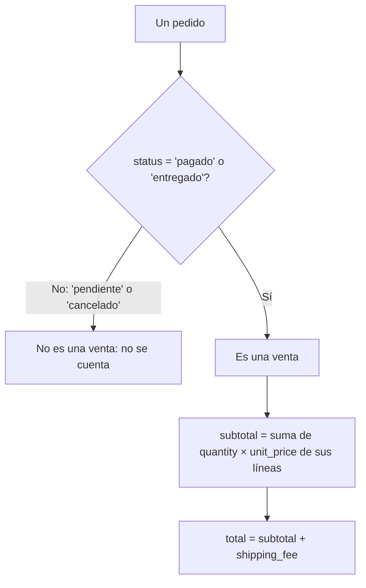
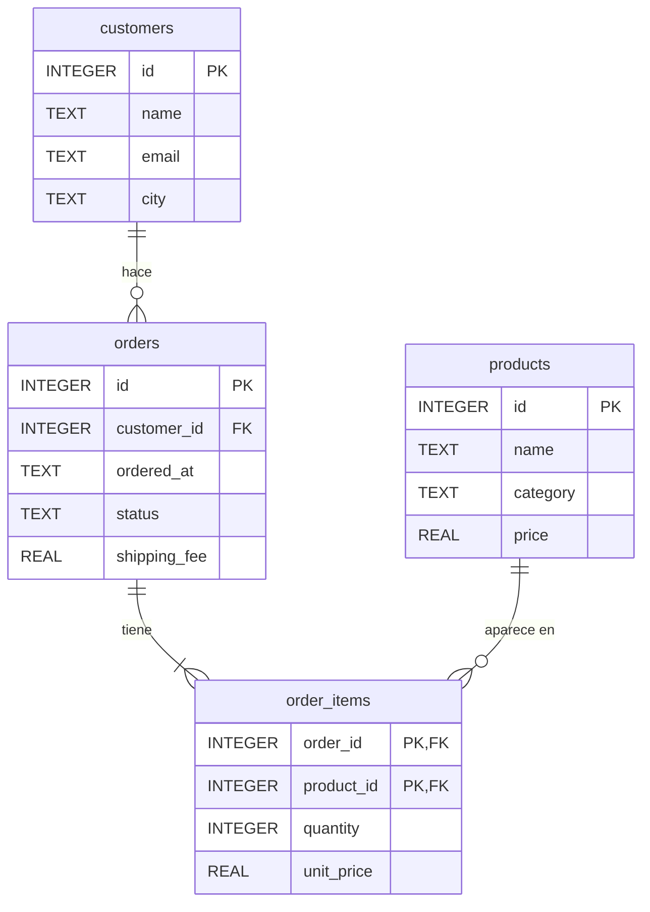

# 📋 Brief · Pedidos de una tienda en línea

## La pregunta del dominio
> ¿Cuánto nos compró de verdad cada cliente?

Todas las preguntas del equipo de la tienda salen de esta. Un pedido que nadie pagó no es una venta, y un cliente que todavía no compró también es parte de la respuesta.

## Contexto
Tinta Viva es una tienda en línea de útiles de escritorio en Arequipa. Sus datos viven en cuatro tablas relacionadas: los clientes, los productos, los pedidos y las líneas de cada pedido. Tienen lo que tiene cualquier tienda real: pedidos cancelados o sin pagar, precios que cambiaron desde que alguien compró, compras de personas que no se registraron y clientes que nunca compraron.

El equipo te hace seis preguntas. Respondes cada una con **una consulta** en un archivo `.sql`, y las pruebas de [`acceptance/`](acceptance/) las corren contra los datos de la tienda.

**Hoy es el 30 de noviembre de 2026** en todas las preguntas. Escríbelo como texto, `'2026-11-30'`: así las respuestas no cambian según el día en que corras las pruebas. No uses `DATE('now')`: devuelve el día real, y tus resultados cambiarían de un día a otro.

Los pedidos guardan el día **y la hora** en que se hicieron: `ordered_at` es un texto como `'2026-09-05 10:20'`.

## Dominio

### Las reglas
| Regla | Qué significa |
|---|---|
| **Venta** | Un pedido es una venta si su `status` es `'pagado'` o `'entregado'`. Un pedido `'pendiente'` (todavía sin pagar) o `'cancelado'` no es una venta, y nada de lo que tiene adentro se cuenta. |
| **Importe de una línea** | `quantity` × `unit_price`. `unit_price` es el precio que pagó el cliente ese día; `price`, en `products`, es el precio de hoy en el catálogo, y puede ser otro. |
| **Subtotal y total de una venta** | El subtotal es la suma de los importes de sus líneas. El total es el subtotal más el costo de envío del pedido, `shipping_fee`, que se cobra una vez por pedido. |
| **Cliente** | Una persona registrada en `customers`, que se identifica por su `id`. Un pedido con `customer_id` `NULL` lo hizo un invitado, alguien que compró sin registrarse: cuenta como venta si su `status` lo dice, pero no es de ningún cliente. Donde se muestra quién compró, un invitado se muestra como `'Invitado'`. |
| **Dinero** | Todo monto que se muestra (`total`, `revenue`, `subtotal`, `spent`) va en soles, redondeado a 2 decimales. |

### Las tablas

`order_items` es la tabla intermedia (*join table*, lab 2.1) entre pedidos y productos: una fila por cada producto de un pedido. Su clave primaria son dos columnas juntas, `(order_id, product_id)`: un producto aparece una sola vez en cada pedido, con la cantidad que se llevó.

| Tabla | Columna | Tipo | Qué guarda |
|---|---|---|---|
| `customers` | `id`, `name`, `email`, `city` | `INTEGER`, `TEXT` | El número del cliente, su nombre, su correo y su ciudad |
| `products` | `id`, `name`, `category` | `INTEGER`, `TEXT` | El número del producto, su nombre y su categoría |
| `products` | `price` | `REAL` | El precio de hoy en el catálogo, en soles |
| `orders` | `id` | `INTEGER` | El número del pedido |
| `orders` | `customer_id` | `INTEGER` | El cliente que lo hizo (→ `customers.id`); `NULL` si lo hizo un invitado |
| `orders` | `ordered_at` | `TEXT` | Cuándo se hizo, `'AAAA-MM-DD HH:MM'` |
| `orders` | `status` | `TEXT` | `'pendiente'`, `'pagado'`, `'entregado'` o `'cancelado'` |
| `orders` | `shipping_fee` | `REAL` | El costo de envío del pedido, en soles (0 si el envío fue gratis) |
| `order_items` | `order_id`, `product_id` | `INTEGER` | El pedido (→ `orders.id`) y el producto (→ `products.id`) |
| `order_items` | `quantity` | `INTEGER` | Cuántas unidades se llevó |
| `order_items` | `unit_price` | `REAL` | El precio de una unidad el día del pedido, en soles |

### Los datos
Estos son todos los datos (los crea [`acceptance/seed.sql`](acceptance/seed.sql)).

`customers`:

| id | name | email | city |
|---|---|---|---|
| 1 | Lucía Torres | lucia.torres@example.com | Arequipa |
| 2 | María López | maria.lopez@example.com | Lima |
| 3 | Jorge Ríos | jorge.rios@example.com | Cusco |
| 4 | María López | mlopez.trujillo@example.com | Trujillo |
| 5 | Rosa Huamán | rosa.huaman@example.com | Arequipa |
| 6 | Pedro Salas | pedro.salas@example.com | Puno |
| 7 | Andrés Vega | andres.vega@example.com | Lima |
| 8 | Carla Mendoza | carla.mendoza@example.com | Tacna |

`products`:

| id | name | category | price |
|---|---|---|---|
| 1 | Cuaderno A4 cuadriculado | Cuadernos | 12.5 |
| 2 | Agenda 2027 | Cuadernos | 39.9 |
| 3 | Lapicero gel azul x12 | Escritura | 18.0 |
| 4 | Resaltadores x6 | Escritura | 15.9 |
| 5 | Mochila escolar | Mochilas | 129.0 |
| 6 | Cartuchera doble | Mochilas | 34.75 |
| 7 | Papel bond A4 x500 | Papel | 28.0 |
| 8 | Calculadora científica | Tecnología | 79.0 |
| 9 | Pizarra acrílica | Oficina | 65.0 |

`orders`:

| id | customer_id | ordered_at | status | shipping_fee |
|---|---|---|---|---|
| 101 | 1 | 2026-09-05 10:20 | entregado | 10.0 |
| 102 | 2 | 2026-09-18 16:45 | entregado | 0.0 |
| 103 | 3 | 2026-10-02 09:00 | entregado | 12.0 |
| 104 | 5 | 2026-10-10 18:30 | cancelado | 10.0 |
| 105 | `NULL` | 2026-10-30 12:00 | entregado | 15.0 |
| 106 | 4 | 2026-10-31 20:15 | entregado | 10.0 |
| 107 | 1 | 2026-11-08 11:10 | pagado | 10.0 |
| 108 | 8 | 2026-11-15 15:40 | entregado | 12.0 |
| 109 | 7 | 2026-11-22 10:00 | pendiente | 10.0 |
| 110 | 2 | 2026-11-30 09:30 | pagado | 0.0 |
| 111 | 3 | 2026-11-26 19:05 | cancelado | 12.0 |

`order_items`:

| order_id | product_id | quantity | unit_price |
|---|---|---|---|
| 101 | 1 | 4 | 12.5 |
| 101 | 3 | 1 | 18.0 |
| 102 | 5 | 1 | 119.0 |
| 102 | 6 | 1 | 34.75 |
| 103 | 8 | 1 | 79.0 |
| 104 | 5 | 3 | 119.0 |
| 105 | 7 | 3 | 28.0 |
| 105 | 4 | 2 | 16.0 |
| 106 | 2 | 2 | 45.0 |
| 106 | 1 | 2 | 12.5 |
| 107 | 3 | 2 | 18.0 |
| 107 | 4 | 1 | 14.0 |
| 108 | 5 | 2 | 129.0 |
| 109 | 7 | 2 | 28.0 |
| 110 | 6 | 2 | 34.75 |
| 110 | 1 | 1 | 12.5 |
| 111 | 8 | 1 | 79.0 |

## Contrato
Tu entrega es una carpeta `my-queries/`, junto a `acceptance/` y `reference/`, con **seis archivos `.sql` de una sola consulta cada uno**, con estos nombres exactos. Las columnas se comparan por nombre y en este orden, y las filas, también en el orden pedido.

| Archivo | La pregunta del equipo | Columnas | Orden |
|---|---|---|---|
| `01_order_totals.sql` | Para contabilidad: el total de cada venta, con el nombre de quien compró (`'Invitado'` si compró sin registrarse) | `order_id`, `customer`, `total` | Por `order_id`, de menor a mayor |
| `02_no_purchases.sql` | Para la campaña «tu primera compra»: los clientes registrados que no tienen ninguna venta | `id`, `name`, `email` | Por `id`, de menor a mayor |
| `03_categories.sql` | Las categorías que más venden: por categoría, cuántas ventas tienen al menos un producto de ella (`orders`), cuántas unidades se vendieron (`units`) y la suma de los importes de esas líneas (`revenue`, sin envío). Solo las categorías con `revenue` de 100 soles o más | `category`, `orders`, `units`, `revenue` | De mayor a menor `revenue`; empates por `category` |
| `04_big_orders.sql` | Las ventas grandes: las ventas cuyo subtotal es mayor que el subtotal promedio de las ventas | `order_id`, `subtotal` | De mayor a menor `subtotal`; empates por `order_id` |
| `05_best_sellers.sql` | Los más vendidos del último mes: por producto, las unidades vendidas en las ventas de los últimos 30 días, desde el día que cae 30 días antes de hoy (incluido) hasta hoy, a cualquier hora. Solo los productos que se vendieron en esos días. La web muestra 4 por página: devuelve **la página 2** | `product_id`, `name`, `units` | De más a menos `units`; empates por `name`, de la A a la Z |
| `06_customers.sql` | **La pregunta del dominio:** cada cliente registrado, también los que no compraron, con cuántas ventas hizo (`orders`) y cuánto gastó en ellas (`spent`: la suma de los totales de sus ventas, con envío; 0 si no compró) | `customer_id`, `name`, `orders`, `spent` | De mayor a menor `spent`, después por `name` de la A a la Z, después por `customer_id` |

Los nombres de las columnas van tal cual, en inglés y en minúsculas, como en los labs. «De la A a la Z» es el orden de `ORDER BY` en SQLite (lab 1.5): ningún texto de este proyecto depende de cómo se ordenan las tildes.

**Contrato de errores:** las pruebas no esperan errores. Si un archivo falta, no tiene una consulta o tiene dos, la prueba de esa pregunta falla con un mensaje en español que dice cuál es el problema (los mensajes son los de los labs; repásalos en [cómo se revisa tu trabajo](../../01-query-a-table/02-first-queries/README.md#cómo-se-revisa-tu-trabajo)).

## Criterios de aceptación
1. **Dados** los datos de `seed.sql`, **cuando** corres `01_order_totals.sql`, **entonces** sale cada venta con quien la hizo y su total, por número de pedido. → `TestTask1OrderTotals`
2. **Dados** los datos, **cuando** corres `02_no_purchases.sql`, **entonces** salen los clientes registrados sin ninguna venta, por `id`. → `TestTask2NoPurchases`
3. **Dados** los datos, **cuando** corres `03_categories.sql`, **entonces** salen las categorías que vendieron 100 soles o más, con sus ventas, unidades e importe, en el orden pedido. → `TestTask3Categories`
4. **Dados** los datos, **cuando** corres `04_big_orders.sql`, **entonces** salen las ventas con un subtotal mayor que el promedio, en el orden pedido. → `TestTask4BigOrders`
5. **Dado** que hoy es el 2026-11-30, **cuando** corres `05_best_sellers.sql`, **entonces** sale la página 2 de los más vendidos de los últimos 30 días. → `TestTask5BestSellers`
6. **Dados** los datos, **cuando** corres `06_customers.sql`, **entonces** sale cada cliente registrado con sus ventas y lo que gastó, en el orden pedido. → `TestTask6Customers`

## Requisitos no funcionales
| Requisito | Lo enseñó |
|---|---|
| Una sola consulta por archivo, con las columnas nombradas con `AS` | [Lab 1.2](../../01-query-a-table/02-first-queries/README.md) |
| Cada unión sigue una clave foránea hasta su clave primaria | [Lab 2.1](../01-table-relationships/README.md), [lab 2.2](../02-join-tables/README.md) |
| Una pregunta que pide «todos» o «también los que no» no pierde filas al unir | [Lab 2.3](../03-unmatched-rows/README.md) |
| Cada conteo y cada suma se calculan en la consulta, con funciones de agregado | [Lab 2.4](../04-group-and-summarize/README.md), [lab 2.5](../05-filter-groups/README.md) |
| Un filtro sobre un resumen va donde puede ver el resumen | [Lab 2.5](../05-filter-groups/README.md) |
| Una pregunta que compara con otro resultado de los mismos datos lo calcula en la misma consulta, no escrito a mano | [Lab 2.6](../06-subqueries/README.md) |
| Todo orden pedido tiene su desempate, y la paginación da siempre las mismas filas | [Lab 1.5](../../01-query-a-table/05-sort-and-paginate/README.md) |
| Las fechas se comparan como texto ISO-8601 sin perder las que tienen hora; hoy es `'2026-11-30'`, escrito en la consulta | [Lab 1.6](../../01-query-a-table/06-transform-values/README.md), [proyecto 1.P](../../01-query-a-table/project-shop-catalog/BRIEF.md) |

## Qué es nuevo aquí
- **Una clave primaria de dos columnas.** `order_items` no tiene `id`: cada fila se identifica por la pareja `(order_id, product_id)`. Se une igual que en el lab 2.2, cada columna con la tabla a la que apunta.
- **Varias tablas y varias reglas en una consulta.** Cada lab tenía una idea por tarea; aquí una consulta junta la unión de un lab, el grupo de otro y el filtro de un tercero. Escríbela por partes: primero el `FROM` con sus `JOIN` y el `WHERE`, y mira qué filas salen; después el `GROUP BY` y las columnas calculadas, y al final el `HAVING` y el `ORDER BY`. Para revisar un número, compáralo con la cuenta a mano sobre las tablas de arriba.

### Tu caja de herramientas
Todo lo que necesitas ya lo viste en los labs. Si no recuerdas una herramienta, vuelve a su sección:

- Unir dos o más tablas: [lab 2.2, *JOIN*](../02-join-tables/README.md#unir-dos-tablas-join) y [más de dos tablas](../02-join-tables/README.md#más-de-dos-tablas).
- Conservar las filas sin pareja y encontrar lo que falta: [lab 2.3, *LEFT JOIN*](../03-unmatched-rows/README.md#quedarse-también-con-las-filas-sin-pareja-left-join), [*anti-join*](../03-unmatched-rows/README.md#encontrar-lo-que-no-tiene-pareja-anti-join) y [qué hace el `ON` y qué hace el `WHERE`](../03-unmatched-rows/README.md#qué-hace-el-on-y-qué-hace-el-where).
- Resumir por grupos: [lab 2.4, `GROUP BY`](../04-group-and-summarize/README.md#un-resumen-por-grupo-group-by), [contar cada valor una vez](../04-group-and-summarize/README.md#contar-cada-valor-una-vez-distinct) y [agrupar el resultado de un `JOIN`](../04-group-and-summarize/README.md#agrupar-el-resultado-de-un-join).
- Filtrar grupos: [lab 2.5, `HAVING`](../05-filter-groups/README.md#quedarte-con-algunos-grupos-having).
- Resumir en una subconsulta en el `FROM` antes de unir: [lab 2.5](../05-filter-groups/README.md#una-consulta-agrupada-dentro-del-from).
- Usar el resultado de otra consulta: [lab 2.6, un valor](../06-subqueries/README.md#un-valor-calculado-por-otra-consulta-scalar-subquery), [una lista con `IN` y `NOT IN`](../06-subqueries/README.md#una-lista-calculada-por-otra-consulta-in-y-not-in), [una subconsulta correlacionada](../06-subqueries/README.md#una-subconsulta-que-mira-la-fila-de-afuera-correlated-subquery) y [`EXISTS`](../06-subqueries/README.md#existe-alguna-fila-exists-y-not-exists).
- Restar días a una fecha, `DATE(fecha, '-N days')`: [proyecto 1.P](../../01-query-a-table/project-shop-catalog/BRIEF.md#qué-es-nuevo-aquí).

## Fijo y libre
- **Fijo:** los nombres de los archivos, las columnas y su orden, el orden de las filas, los datos de `seed.sql` y que hoy es `'2026-11-30'`.
- **A tu elección:** cómo escribes cada consulta. Hay varias formas correctas de casi todo (`JOIN` o subconsulta, `NOT EXISTS` o *anti-join*, `IN` u `OR`, agrupar antes o después de unir); las pruebas solo miran el resultado. Si hiciste el lab 2.7 (electivo), puedes usar `UNION` o `EXCEPT`, pero ninguna pregunta los necesita.

## Fuera de alcance
- **Guardar una regla una sola vez.** La regla «venta» se repite en casi todas las consultas, y el total de cada venta en varias; escribir una consulta larga como una serie de pasos con nombre (`WITH`) es del lab 4.1.
- **Rankings con empates numerados** («el 1.º, el 2.º…»): las funciones de ventana son del lab 4.3.
- **Cambiar los datos.** Registrar un pedido o cancelarlo (`INSERT`, `UPDATE`) es del lab 3.4, y que todos los cambios de un pedido ocurran juntos o ninguno, del lab 3.5.
- **La fecha real.** `DATE('now')` devuelve el día de hoy, pero entonces las pruebas cambiarían de un día a otro.
